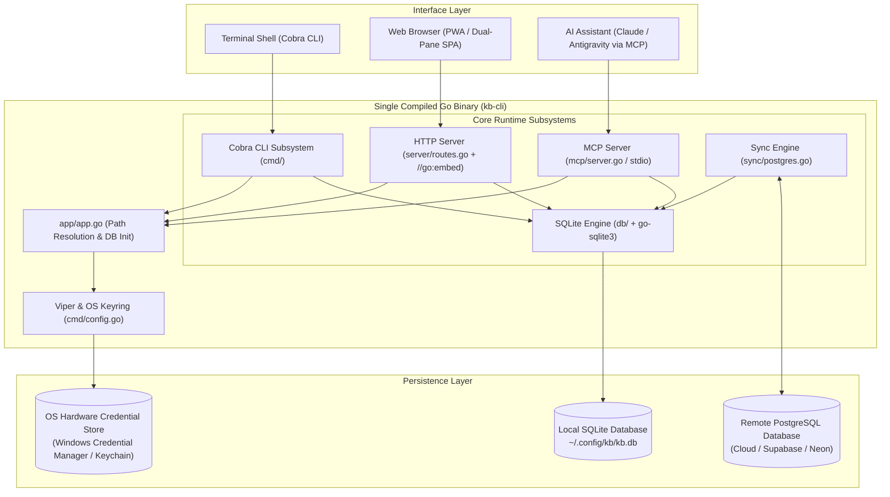

# 01. Complete System Architecture & Runtime Lifecycle

## 1. System Vision & Architecture Topology

`kb-cli` is a local-first, terminal-centric personal knowledge base and second brain written in **Go (1.23+)**. It is designed around the core belief that personal thought capture and retrieval must be friction-free, instantaneous (< 50ms), and autonomous.

The application unifies five primary operational interfaces into a single standalone static binary:
1. **The CLI Command Interface:** Fast, positional command-line commands for capturing, listing, triaging, editing, and deleting notes without leaving the terminal.
2. **The Embedded Web Application:** A modern, zero-dependency dual-pane fuzzy finder with live Markdown and Mermaid diagram rendering, installable as an offline Progressive Web App (PWA).
3. **The Embedded SQLite Engine:** Local-first storage with Write-Ahead Logging (WAL) and SQLite FTS5 for instant sub-millisecond keyword and facet queries.
4. **The Bidirectional PostgreSQL Sync Engine:** Cloud replication engine that synchronizes notes, tags, links, daily logs, and audit trails across machines using timestamp watermarks.
5. **The Model Context Protocol (MCP) Server:** Stdio-based AI assistant interface allowing agents (Claude, Antigravity, Cursor, Cline) to read, search, curate, link, and audit notes autonomously.



---

## 2. Startup Lifecycle & Runtime Initialization

Every execution of `kb-cli`—whether running a quick note capture (`kb "thought"`), launching the web server (`kb serve http`), or starting the MCP server (`kb serve mcp`)—passes through a deterministic initialization lifecycle in [app/app.go](file:///e:/kb-cli/kb-cli/app/app.go):

### 2.1 Configuration Path Resolution
1. **Config Path Detection:** The application first checks if the user passed `--config <path>` or set `KB_CONFIG`. If omitted, it resolves the platform-standard configuration directory:
   - Windows: `%USERPROFILE%\.config\kb\config.yaml`
   - macOS / Linux: `~/.config/kb/config.yaml`
2. **Directory Bootstrapping:** If `~/.config/kb/` does not exist, `app.InitApp()` creates the directory tree with secure permissions (`0755`).
3. **Database Path Resolution:** Reads `base_path` from `config.yaml` (expanding `~` if present). If not specified, it defaults to `filepath.Join(configDir, "kb.db")`.

### 2.2 Database Initialization & WAL Mode
In [db/db.go](file:///e:/kb-cli/kb-cli/db/db.go):
1. **Driver Loading:** Opens the SQLite database using `mattn/go-sqlite3` with connection string parameters tuned for maximum throughput and concurrency:
   ```text
   file:~/.config/kb/kb.db?_journal_mode=WAL&_busy_timeout=5000&_foreign_keys=ON
   ```
2. **Write-Ahead Logging (WAL):** By enabling WAL mode, readers never block writers, and writers never block readers. This allows the embedded web server, CLI commands, and MCP background tasks to access the database concurrently without database locked errors.
3. **Schema Verification (`InitSchema`):** Executes [db/schema.sql](file:///e:/kb-cli/kb-cli/db/schema.sql) using `CREATE TABLE IF NOT EXISTS` and `CREATE INDEX IF NOT EXISTS`. Schema verification takes less than 1.5ms on modern SSDs.

---

## 3. Subsystem Architecture

### 3.1 The Cobra Command Subsystem (`cmd/`)
The CLI is built around a centralized Cobra root command (`rootCmd` in `cmd/root.go`). 

#### Positional Fast Capture Mode
If `kb-cli` is invoked with arguments that do not match any registered subcommand:
```bash
kb "Refactor auth middleware to use http.HandlerFunc"
```
Cobra's `Args` validator detects that the first argument is not a command. It intercepts the string and routes it directly to `cmd.ExecuteQuickAdd(args)`, saving a `raw` note to SQLite in under **25 milliseconds**.

#### Modular Command Registration
Each feature area is isolated in its own file in `cmd/`:
- **`cmd/add.go`**: Note creation with flags for type, status, area, due date, and `$EDITOR` opening.
- **`cmd/edit.go`**: Interactive terminal editing menus and programmatic updates.
- **`cmd/list.go` & `cmd/fuzzy.go`**: Formatted tabular displays and terminal fuzzy finding.
- **`cmd/log.go` & `cmd/promote.go`**: Chronological daily micro-logging stream and promotion.
- **`cmd/inbox.go` & `cmd/triage.go`**: Triage queues for processing raw ideas into refined notes.
- **`cmd/sync.go`**: CLI entrypoints for PostgreSQL synchronization.
- **`cmd/serve.go`**: Starts either the HTTP Web server or the MCP stdio server.

---

### 3.2 The Embedded HTTP Web Server (`server/`)
The web server runs a high-performance HTTP multiplexer via Go's standard `net/http` package:

#### Embedded Virtual Filesystem (`//go:embed`)
In [server/routes.go](file:///e:/kb-cli/kb-cli/server/routes.go#L20-L22):
```go
//go:generate npm run build
//go:embed web/*
var embeddedFiles embed.FS
```
During the build phase (`go build`), the minified JavaScript bundle (`app.min.js`), stylesheets (`style.min.css`), vendor libraries (`github-dark.min.css`), PWA manifest, and icons are embedded directly into the binary's data segment. The compiled binary is entirely self-sufficient—it can be copied to a bare server without `node_modules` or web assets.

#### REST API Endpoints
All API endpoints are mounted under `/api/` and return clean JSON payloads:
- `POST /api/auth/login`: Validates PIN / credentials and issues a session cookie.
- `GET  /api/auth/status`: Checks if authentication is required and if the current session is valid.
- `POST /api/auth/logout`: Clears the session.
- `GET  /api/items`: Returns compact note and log payloads optimized for the client-side fuzzy index.
- `GET  /api/notes`: Lists notes with optional query parameter filters.
- `POST /api/notes`: Creates a new note.
- `GET  /api/notes/{id}`: Retrieves full note details including `note_flesh`, tags, and links.
- `PUT  /api/notes/{id}`: Updates note headline, flesh, or metadata.
- `DELETE /api/notes/{id}`: Performs a non-destructive soft-delete with an audit note.
- `GET  /api/logs`: Returns daily stream micro-logs.
- `POST /api/logs`: Appends a micro-log to today's stream.
- `GET  /api/tags`: Returns all unique tags with note usage counts.
- `GET  /api/stats`: Returns database totals (notes by type, status, area, links, logs).
- `POST /api/sync`: Triggers immediate bidirectional sync with remote PostgreSQL.

#### Single-Page Application (SPA) Fallback
Any request path that does not match an `/api/` route and does not correspond to a static asset file is routed directly to `index.html`. This enables client-side URL routing without returning 404s on hard refresh.

---

### 3.3 The Model Context Protocol (MCP) Server (`mcp/`)
The MCP server operates over standard input/output (`stdio`) using JSON-RPC 2.0. It allows modern LLMs to use `kb-cli` as external persistent memory.

- **Isolation:** Stdio transport ensures zero network attack surface; the server communicates only with the parent process that spawned it.
- **Audit Attribution:** Every modification executed via an MCP tool (`create_note`, `update_note`, `delete_note`) is recorded in `audit_logs` with the action attribution marked as `"deleted by AI"` or `"updated by AI agent"`.
- **Token Efficiency:** The `list_notes` and `search_notes` tools return compact summaries by default (`compact: true`), preventing large context window consumption in LLM sessions.

---

### 3.4 The PostgreSQL Sync Subsystem (`sync/`)
The synchronization engine provides cloud persistence without sacrificing local-first speed:
- Operates on timestamp watermarks (`sync_state.last_synced_at`).
- Leverages Go's goroutines to pull remote changes concurrently across notes, tags, links, logs, and audit entries.
- Wraps local merges in atomic SQLite transactions, featuring automatic tag harmonization to resolve cross-machine ID conflicts.
- Pushes local changes in batched multi-row SQL queries with Last-Write-Wins (LWW) conflict handling.

---

## 4. Concurrency & Data Flow

```mermaid
sequenceDiagram
    participant User as User / Terminal
    participant Web as Web Client (PWA)
    participant AI as AI Agent (MCP)
    participant SQLite as Local SQLite (WAL Mode)
    participant PG as Remote PostgreSQL

    par User Captures Thought
        User->>SQLite: kb "Idea" -> INSERT INTO notes (status='raw')
    and Web Browser Views Notes
        Web->>SQLite: GET /api/items -> SELECT notes, tags (Concurrent Read)
    and AI Agent Curates
        AI->>SQLite: mcp:link_notes -> INSERT INTO links (Concurrent Write)
    end

    Note over SQLite: SQLite WAL Mode allows concurrent readers + 1 writer without locking

    rect rgb(18, 28, 45)
        Note over SQLite,PG: Background or Manual Sync Reconciliation
        User->>PG: kb sync -> Pull remote delta & Push local delta
        PG-->>SQLite: Harmonize & Commit updated_at watermarks
    end
```



---

## 5. Security & Isolation Boundaries

1. **Local-First Sandboxing:** Data lives on the user's physical machine. No telemetry or analytics are sent to third parties.
2. **OS Keyring Encryption:** Remote database credentials are encrypted using hardware-backed OS keychains (Windows Credential Manager, macOS Keychain, Linux Secret Service). Plaintext passwords are never written to `config.yaml`.
3. **Soft-Delete Safety Net:** Accidental deletions (by human or AI) are non-destructive. Rows remain in SQLite with `deleted_at` timestamps and can be restored at any time via `kb restore <id>`.
4. **Audit Snapshot Trail:** Every mutation records full before/after JSON snapshots in the `audit_logs` table, allowing point-in-time diffing and instant revision reversion via `kb history revert <id> <rev>`.
