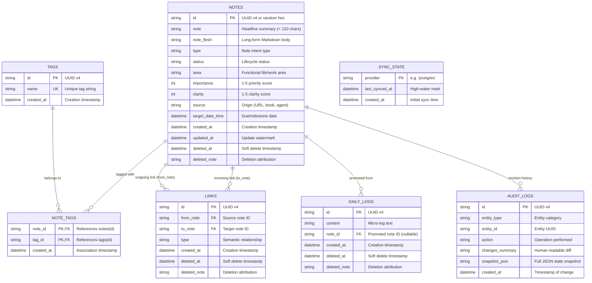

# 02. Active Database Schema & Models

## 1. Storage Overview

The storage architecture of `kb-cli` is implemented in two tiers:
1. **Local Embedded SQLite Tier ([db/schema.sql](file:///e:/kb-cli/kb-cli/db/schema.sql)):** Serves as the primary operational database, running locally at `~/.config/kb/kb.db` with Write-Ahead Logging (WAL) and Full-Text Search (FTS5).
2. **Remote PostgreSQL Tier ([sync/postgres.go](file:///e:/kb-cli/kb-cli/sync/postgres.go)):** Serves as the centralized synchronization hub, mirroring the local relational model using cloud-native PostgreSQL data types (`TIMESTAMPTZ`, `JSONB`).

The schema is built around an **atomic thought model** with distinct headline summaries (`note`), detailed Markdown bodies (`note_flesh`), relational tags, semantic graph edges, daily logs, and revision audit logs.



---

## 2. Table-by-Table Schema Specification

### 2.1 Table: `notes`
The core entity table representing thoughts, tasks, projects, ideas, and decisions.

```sql
CREATE TABLE IF NOT EXISTS notes (
  id TEXT PRIMARY KEY,
  note TEXT,
  note_flesh TEXT,
  type TEXT,
  status TEXT,
  area TEXT,
  importance INTEGER,
  clarity INTEGER,
  source TEXT,
  target_date_time DATETIME,
  created_at DATETIME,
  updated_at DATETIME,
  deleted_at DATETIME,
  deleted_note TEXT
);
```

#### Column Details
- **`id` (TEXT, PK):** Unique record identifier (UUID v4 or truncated 7-character prefix for CLI display).
- **`note` (TEXT):** The concise headline or summary thesis statement. Typically under 120 characters to allow compact presentation in terminal tables, search lists, and LLM context windows.
- **`note_flesh` (TEXT):** The long-form substantive Markdown body. Contains detailed explanations, code blocks, checklists, references, and mathematical reasoning.
- **`type` (TEXT):** Encodes the intent of the note:
  - `'note'`: General atomic thought or synthesis.
  - `'todo'`: Actionable task requiring completion.
  - `'project'`: Multi-step initiative grouping related notes.
  - `'idea'`: Nascent, unvalidated concept or hypothesis.
  - `'decision'`: Architecture Decision Record (ADR) capturing evaluated options and trade-offs.
  - `'concept'`: Enduring mental model, definition, or systemic abstraction.
  - `'til'`: "Today I Learned" — discrete discovery or technique.
  - `'resource'`: Reference, bookmark, documentation link, or tool review.
  - `'question'`: Open research inquiry.
  - `'experiment'`: Empirical test, benchmark, or experiment log.
  - `'person'`: Colleague, collaborator, author, or subject expert.
- **`status` (TEXT):** Represents progressive refinement lifecycle:
  - `'raw'`: Chaotic, unedited initial capture.
  - `'refined'`: Structured, reviewed, and categorized.
  - `'in-progress'`: Actively being executed.
  - `'completed'`: Task finished or project concluded.
  - `'archived'`: Retired knowledge preserved for reference.
- **`area` (TEXT):** Functional domain (e.g., `'work'`, `'finance'`, `'health'`, `'personal'`).
- **`importance` (INTEGER, 1-5):** Priority rating from 1 (low) to 5 (critical).
- **`clarity` (INTEGER, 1-5):** Articulation score from 1 (vague idea) to 5 (completely refined).
- **`source` (TEXT):** Attribution (e.g., `'AI Agent'`, `'Web'`, `'Book: DDIA'`).
- **`target_date_time` (DATETIME, Nullable):** Target due date, deadline, or milestone timestamp.
- **`created_at` (DATETIME):** Timestamp of initial creation.
- **`updated_at` (DATETIME):** Monotonically updated timestamp for sync watermarking.
- **`deleted_at` (DATETIME, Nullable):** Non-destructive soft-delete tombstone timestamp.
- **`deleted_note` (TEXT, Nullable):** Context or attribution explaining why the note was deleted.

---

### 2.2 Tables: `tags` & `note_tags`
Implements a normalized many-to-many relationship without embedding inline `#tags` into prose.

```sql
CREATE TABLE IF NOT EXISTS tags (
  id TEXT PRIMARY KEY,
  name TEXT UNIQUE,
  created_at DATETIME
);

CREATE TABLE IF NOT EXISTS note_tags (
  note_id TEXT,
  tag_id TEXT,
  created_at DATETIME,
  PRIMARY KEY (note_id, tag_id)
);
```

#### Foreign Keys & Cascading
In PostgreSQL:
```sql
CREATE TABLE IF NOT EXISTS note_tags (
  note_id VARCHAR(64) REFERENCES notes(id) ON DELETE CASCADE,
  tag_id VARCHAR(64) REFERENCES tags(id) ON DELETE CASCADE,
  created_at TIMESTAMPTZ DEFAULT NOW(),
  PRIMARY KEY (note_id, tag_id)
);
```
- Tag names are unique (`UNIQUE` constraint on `name`).
- Associating or removing tags requires inserting or deleting rows from `note_tags`.
- Tag names support hierarchical namespace notation (e.g., `'tech/golang'`, `'project/kb'`).

---

### 2.3 Table: `links`
Stores directional semantic relationships connecting notes in an interconnected knowledge graph.

```sql
CREATE TABLE IF NOT EXISTS links (
  id TEXT PRIMARY KEY,
  from_note TEXT,
  to_note TEXT,
  type TEXT,
  created_at DATETIME,
  deleted_at DATETIME,
  deleted_note TEXT
);
```

#### Semantic Relationship Types (`type`)
- `'related_to'`: General associative connection (bidirectional semantics).
- `'part_of'`: Component-to-whole relationship (e.g., task is part of project).
- `'inspired_by'`: Lineage of thought (e.g., idea inspired by article).
- `'depends_on'`: Prerequisite dependency (e.g., task B depends on task A).
- `'supports'`: Evidence, benchmark, or supporting argument.
- `'contradicts'`: Counterpoint or competing hypothesis.
- `'about'`: Topical connection (e.g., note is about a concept).
- `'created_by'`: Attribution (e.g., project created by a person).

---

### 2.4 Table: `daily_logs`
Chronological micro-stream for timestamped thoughts recorded throughout the day.

```sql
CREATE TABLE IF NOT EXISTS daily_logs (
  id TEXT PRIMARY KEY,
  content TEXT,
  note_id TEXT,
  created_at DATETIME,
  deleted_at DATETIME,
  deleted_note TEXT
);
```

- **`content` (TEXT):** Raw log text.
- **`note_id` (TEXT, Nullable):** If the log is promoted to a permanent note via `kb promote <id>`, this column records the promoted note's UUID, linking the micro-log to its evolved form.
- **`deleted_at` (DATETIME, Nullable):** Soft-delete timestamp.

---

### 2.5 Table: `sync_state`
Tracks replication progress with external synchronization providers.

```sql
CREATE TABLE IF NOT EXISTS sync_state (
  provider TEXT PRIMARY KEY,
  last_synced_at DATETIME,
  created_at DATETIME
);
```

- When syncing with PostgreSQL, `provider` is `'postgres'`.
- `last_synced_at` stores the high-water mark timestamp used in subsequent sync runs.

---

### 2.6 Table: `audit_logs`
Centralized immutable change journal recording point-in-time snapshots for version history and reversion.

```sql
CREATE TABLE IF NOT EXISTS audit_logs (
  id TEXT PRIMARY KEY,
  entity_type TEXT NOT NULL,
  entity_id TEXT NOT NULL,
  action TEXT NOT NULL,
  changes_summary TEXT,
  snapshot_json TEXT,
  created_at DATETIME NOT NULL
);
```

- **`entity_type`:** `'note'`, `'daily_log'`, or `'link'`.
- **`action`:** `'create'`, `'update'`, `'delete'`, or `'promote'`.
- **`changes_summary`:** Human-readable diff summary (e.g., `"Updated title from X to Y"`).
- **`snapshot_json`:** Full serialized JSON dump of the entity before/after mutation, enabling `kb history revert <id> <rev>`.

---

## 3. SQLite Full-Text Search Virtual Table (`notes_fts`)

Full-text search is implemented natively in SQLite using **FTS5**:

```sql
CREATE VIRTUAL TABLE IF NOT EXISTS notes_fts USING fts5(
  note,
  note_flesh,
  note_id UNINDEXED
);
```

### Search Operation
Queries execute using SQLite FTS5 MATCH syntax:
```sql
SELECT n.id, n.note, n.type, n.status, n.created_at
FROM notes n
JOIN notes_fts fts ON n.id = fts.note_id
WHERE notes_fts MATCH ? AND n.deleted_at IS NULL;
```
FTS5 tokenizes words automatically, supporting prefix queries (e.g., `postgre*`), boolean operators (`postgres AND sync`), and exact phrase matches (`"WAL mode"`).

---

## 4. Performance Indexes

The database maintains 7 dedicated B-Tree indexes to ensure sub-millisecond query performance:

```sql
-- Fast filtering of active vs soft-deleted notes
CREATE INDEX IF NOT EXISTS idx_notes_deleted_at ON notes(deleted_at);

-- Filtering notes by intent type (todo, note, project, idea)
CREATE INDEX IF NOT EXISTS idx_notes_type ON notes(type);

-- Filtering notes by lifecycle status (active, raw, completed)
CREATE INDEX IF NOT EXISTS idx_notes_status ON notes(status);

-- Bidirectional graph traversal (finding incoming and outgoing links)
CREATE INDEX IF NOT EXISTS idx_links_from_to ON links(from_note, to_note);

-- Chronological daily stream queries (today, date ranges)
CREATE INDEX IF NOT EXISTS idx_daily_logs_created_at ON daily_logs(created_at);

-- Entity-specific version history queries
CREATE INDEX IF NOT EXISTS idx_audit_entity ON audit_logs(entity_type, entity_id, created_at DESC);

-- Chronological global audit stream
CREATE INDEX IF NOT EXISTS idx_audit_created_at ON audit_logs(created_at DESC);
```

---

## 5. Go Models & Struct Definitions (`models/`)

The database maps directly to Go structs defined in `models/`:

### 5.1 `models.Note` ([models/note.go](file:///e:/kb-cli/kb-cli/models/note.go))
```go
type Note struct {
    ID             string
    Note           string
    NoteFlesh      string
    Type           NoteType
    Status         Status
    Area           Area
    CreatedAt      time.Time
    UpdatedAt      time.Time
    DeletedAt      time.Time
    DeletedNote    string
    Importance     int
    Clarity        int
    Source         string
    TargetDateTime time.Time
}
```

### 5.2 `models.Tag` & `models.NoteTag` ([models/tag.go](file:///e:/kb-cli/kb-cli/models/tag.go) & [models/notetag.go](file:///e:/kb-cli/kb-cli/models/notetag.go))
```go
type Tag struct {
    ID        string    `json:"id"`
    Name      string    `json:"name"`
    CreatedAt time.Time `json:"created_at"`
}

type NoteTag struct {
    NoteID    string    `json:"note_id"`
    TagID     string    `json:"tag_id"`
    CreatedAt time.Time `json:"created_at"`
}
```

### 5.3 `models.Link` ([models/link.go](file:///e:/kb-cli/kb-cli/models/link.go))
```go
type Link struct {
    ID          string    `json:"id"`
    FromNote    string    `json:"from_note"`
    ToNote      string    `json:"to_note"`
    Type        LinkType  `json:"type"`
    CreatedAt   time.Time `json:"created_at"`
    DeletedAt   time.Time `json:"deleted_at,omitempty"`
    DeletedNote string    `json:"deleted_note,omitempty"`
}
```

### 5.4 `models.DailyLog` ([models/dailylog.go](file:///e:/kb-cli/kb-cli/models/dailylog.go))
```go
type DailyLog struct {
    ID          string    `json:"id"`
    Content     string    `json:"content"`
    NoteID      string    `json:"note_id,omitempty"`
    CreatedAt   time.Time `json:"created_at"`
    DeletedAt   time.Time `json:"deleted_at,omitempty"`
    DeletedNote string    `json:"deleted_note,omitempty"`
}
```

### 5.5 `models.AuditEntry` ([models/audit.go](file:///e:/kb-cli/kb-cli/models/audit.go))
```go
type AuditAction string

const (
    AuditCreate  AuditAction = "create"
    AuditUpdate  AuditAction = "update"
    AuditDelete  AuditAction = "delete"
    AuditPromote AuditAction = "promote"
)

type AuditEntry struct {
    ID             string      `json:"id"`
    EntityType     string      `json:"entity_type"`
    EntityID       string      `json:"entity_id"`
    Action         AuditAction `json:"action"`
    ChangesSummary string      `json:"changes_summary"`
    SnapshotJSON   string      `json:"snapshot_json"`
    CreatedAt      time.Time   `json:"created_at"`
}
```
