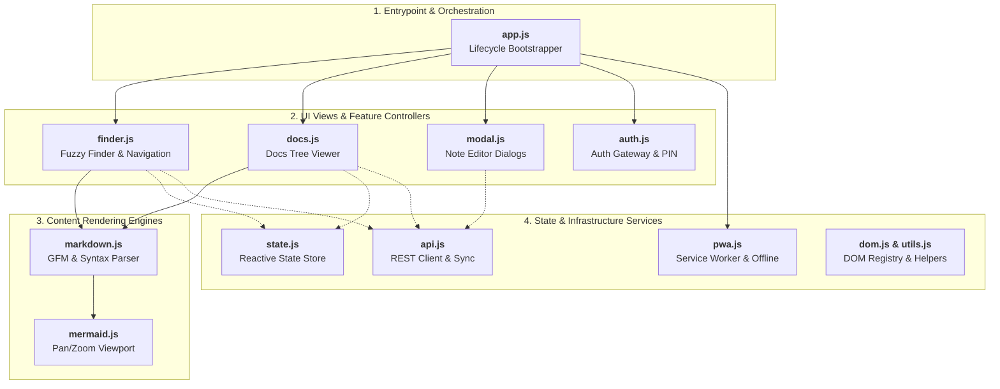

# 04. Embedded Web Fuzzy Finder (PWA Architecture)

## 1. Overview & Technical Stack

The web interface of `kb-cli` is an embedded, client-side Single-Page Application (SPA) designed to serve as an instant, interactive **Fuzzy Finder** with live Markdown and Mermaid preview capabilities. It is embedded directly into the Go binary via `//go:embed web/*` in [server/routes.go](file:///e:/kb-cli/kb-cli/server/routes.go).

### Key Architectural Constraints
1. **Zero Runtime Dependencies:** The frontend runs on vanilla ES Modules (ESM). It does not require Node.js, React, Vue, or Webpack at runtime.
2. **Build-Time Optimization:** Source JavaScript files in `server/web/js/` and stylesheets in `server/web/style.css` are bundled and minified using `esbuild` (`npm run build`) into `server/web/dist/app.min.js` and `server/web/dist/style.min.css`. The total compressed asset payload is **under 60 KB**.
3. **Progressive Web App (PWA):** Built with Service Worker caching (`sw.js`) and a web app manifest (`site.webmanifest`), allowing full installation as an offline-capable native-like app on desktop, iOS, and Android.
4. **Instant Boot (< 30ms):** Bypasses heavy framework virtual DOM reconciliation, operating with direct, high-performance DOM manipulation.

---

## 2. Frontend Subsystem & Module Breakdown (`server/web/js/`)



### 2.1 Application Entrypoint (`app.js`)
[server/web/js/app.js](file:///e:/kb-cli/kb-cli/server/web/js/app.js) initializes the application lifecycle:
1. Initializes external rendering libraries (`initMarkdownLibraries()`).
2. Initializes the documentation subsystem (`initDocs()`).
3. Registers the Service Worker (`initPWA()`) and sets up offline/online sync listeners.
4. Binds global UI event listeners (fuzzy search input, type filter pills, tag clicks, keyboard shortcuts).
5. Configures modal dialog listeners for note creation and editing.
6. Verifies authentication status (`checkAuthStatus()`). If protected and unauthorized, it triggers the authentication modal; otherwise, it loads data, tags, and stats concurrently.

### 2.2 Global State Store (`state.js`)
Maintains the centralized, mutable application state in memory:
- `allItems`: Raw array of all active notes and daily logs fetched from `/api/items`.
- `filteredItems`: Filtered and scored subset based on active search queries and type/tag pills.
- `selectedIndex`: Zero-based index of the currently highlighted note in the results pane.
- `activeTypeFilter`: Current note type filter (`'all'`, `'note'`, `'todo'`, `'project'`, `'idea'`, `'log'`, `'archived'`).
- `activeTagFilter`: Selected tag string or `null`.
- `searchQuery`: Current text string typed into `#search-input`.
- `isRawView`: Boolean toggle for raw Markdown versus rendered preview.
- `currentViewMode`: Active UI mode (`'notes'` or `'docs'`).
- `docsTree`: Hierarchical documentation directory tree.
- `selectedDocPath`: Path of currently selected markdown document.
- `docsExpandedFolders`: Set of currently expanded tree folder keys.

### 2.3 DOM Reference Registry (`dom.js`)
Caches references to frequently accessed elements (search input, results list container, docs tree, nav tabs, preview title, preview content, filter pills, modal inputs, offline badge) to eliminate repetitive `document.getElementById` queries.

### 2.4 API Communication Layer (`api.js`)
Provides typed, `fetch`-based wrappers communicating with the Go backend:
- `getItems()`: Calls `GET /api/items` to retrieve compact item payloads for client-side search.
- `getNote(id)`: Calls `GET /api/notes/{id}` to fetch full details including `note_flesh`, tags, and links.
- `createNote(payload)`: Calls `POST /api/notes`.
- `updateNote(id, payload)`: Calls `PUT /api/notes/{id}`.
- `deleteNote(id, reason)`: Calls `DELETE /api/notes/{id}`.
- `getTags()`: Calls `GET /api/tags`.
- `getStats()`: Calls `GET /api/stats`.
- `fetchDocsTree()`: Calls `GET /api/docs` to retrieve the documentation directory tree.
- `fetchDocContent(path)`: Calls `GET /api/docs/content?path=...` to load raw markdown content.
- `triggerSync()`: Calls `POST /api/sync` to trigger immediate remote PostgreSQL sync.
- `checkAuthStatus()` / `login(pin)` / `logout()`: Authentication endpoints.

---

## 3. Fuzzy Search Engine & Dual-Pane UI (`finder.js`)

### 3.1 Dual-Pane Layout
The interface utilizes a 50/50 responsive split pane (`.main-split-container`):
- **Left Results Pane (`.results-pane`):** A vertically scrollable list displaying note headlines, type badges, status indicators, and relative timestamps.
- **Right Preview Pane (`.preview-pane`):** A live viewing pane rendering full note details, fleshed body content, syntax-highlighted code blocks, Mermaid diagrams, tags, links, and action buttons.

### 3.2 Fuzzy Search Scoring & Real-Time Filtering
As the user types into `#search-input`, the input event is debounced. Filtering occurs across multiple dimensions:
1. **Type Filter:** Matches `state.activeTypeFilter` (or matches all non-archived items if `'all'` is selected).
2. **Tag Filter:** Matches notes associated with `state.activeTagFilter`.
3. **Fuzzy Text Match:** Matches query terms against note titles, fleshed bodies, areas, and tags. Items with title matches are scored higher than body matches.
4. **Count Badges:** Dynamically updates `#search-count` and pill counts (`#count-all`, `#count-note`, `#count-todo`, etc.).

### 3.3 Keyboard Navigation
The interface is fully operable without touching a mouse:
- `ArrowDown` / `J`: Moves selection to the next note and automatically updates the preview pane.
- `ArrowUp` / `K`: Moves selection to the previous note.
- `/`: Focuses the search input and selects existing text for quick re-typing.
- `Escape`: Clears the search input and returns focus to the results list.
- `N`: Opens the "Create Note" modal dialog.
- `E`: Opens the "Edit Note" modal for the currently selected note.
- `T`: Toggles status of the active note between `active` and `completed`.
- `C`: Copies the short UUID of the selected note to the system clipboard.
- `V`: Toggles the preview pane between rendered HTML and raw Markdown.
- `Enter`: Selects the item or opens edit mode.

---

## 4. Markdown & Diagram Rendering Subsystem

### 4.1 Markdown Engine (`markdown.js`)
Configures `markdown-it` with full GitHub Flavored Markdown (GFM) compatibility:
- **Tables & Task Lists:** Formatted with custom dark-mode CSS styling.
- **Syntax Highlighting:** Uses embedded `highlight.js` with language auto-detection for code blocks (Go, SQL, JavaScript, Python, Bash, JSON, YAML, HTML, CSS). Styled with the sleek `github-dark` theme.
- **Security:** HTML tags in user notes are sanitized to prevent XSS injection while preserving formatted markdown syntax.

### 4.2 Dynamic Mermaid Diagram Engine (`mermaid.js`)
- Detects fenced code blocks with language `mermaid` (````mermaid ... ````).
- Asynchronously parses and renders interactive SVG diagrams (architecture graphs, flowcharts, class diagrams, sequence diagrams).
- **Error Fallback:** If a user types invalid Mermaid syntax, the engine catches the parsing error and renders the raw code block with a clean alert instead of crashing the UI.

---

## 5. Modal Dialogs & Edit System (`modal.js`)

The modal system handles note creation and editing without page reloads:
- **Form Fields:** Note headline summary (`#modal-note-title`), flesh body editor (`#modal-note-flesh`), type selector (`#modal-note-type`), status selector (`#modal-note-status`), area input, due date picker, and comma-separated tag input.
- **Focus Trapping:** Keeps keyboard focus locked within the modal while open.
- **Escape to Close:** `Escape` safely dismisses the modal without discarding changes unless dirty.
- **Hotkeys:** `Ctrl + Enter` (or `Cmd + Enter`) commits the save operation immediately.

---

## 6. Progressive Web App (PWA) & Offline Capabilities

### 6.1 Service Worker Caching (`sw.js`)
The Service Worker intercepts all static asset requests using a **Cache-First strategy**:
- Pre-caches core assets on install:
  - `/` (HTML shell)
  - `/dist/app.min.js`
  - `/dist/style.min.css`
  - `/assets/lib/github-dark.min.css`
  - `/assets/site.webmanifest`
  - `/assets/favicon-96x96.png`, `/assets/apple-touch-icon.png`
- Any asset served from the cache loads instantaneously (0ms network time).

### 6.2 Network Resilience & Offline Badge (`pwa.js`)
- Listens to browser `online` and `offline` events.
- When offline, reveals the `#offline-badge` (`⚡ Offline`) in the header.
- When the network reconnects, automatically triggers `onOnlineSync()`, re-fetching `/api/items` to pull changes made while disconnected.

### 6.3 App Installation (`site.webmanifest`)
- Configured with `display: standalone` and `theme_color: #0d1117`.
- Removes browser address bars and navigation chrome when installed on iOS or Android, providing a native application experience.
