# 05. PostgreSQL Synchronization Engine

## 1. Overview & Architectural Philosophy

`kb-cli` is fundamentally built on a **local-first** philosophy. The user's primary database is a local SQLite file located on their disk (`~/.config/kb/kb.db`), ensuring that all reads, writes, searches, and edits complete in single-digit milliseconds with zero network latency.

However, modern knowledge management requires access across multiple devices—such as a personal laptop, a work workstation, a remote server, or a mobile client. To solve this, `kb-cli` includes a robust, bidirectional synchronization engine implemented in [sync/postgres.go](file:///e:/kb-cli/kb-cli/sync/postgres.go) and [db/sync_helpers.go](file:///e:/kb-cli/kb-cli/db/sync_helpers.go).

The synchronization system connects local SQLite instances to a central PostgreSQL database (whether self-hosted, Supabase, Neon, or AWS RDS). It adheres to four critical engineering principles:

1. **Non-Blocking Local Operations:** You can create, edit, search, and delete notes offline indefinitely. Sync is an asynchronous reconciliation process.
2. **Strict Incremental Watermarking:** Synchronization operations only transfer records that have changed since the last successful sync. Syncing 10 modified notes in a database of 50,000 notes takes milliseconds.
3. **Idempotence & Transactional Integrity:** Every sync operation uses strict SQL transactions. If a network drop occurs mid-sync, all partial operations roll back cleanly without leaving orphan rows or corrupted state.
4. **Non-Destructive Tombstoning:** Deletions are never physical `DELETE` statements. Deleting a note sets `deleted_at` and `deleted_note`, allowing the deletion event to replicate across all devices while preserving referential integrity and audit trails.

---

## 2. Remote PostgreSQL Database Schema

When `kb-cli` connects to a remote PostgreSQL database, it checks whether the schema exists. If tables are missing, it executes the bootstrapping DDL embedded in [sync/postgres.go](file:///e:/kb-cli/kb-cli/sync/postgres.go#L44-L112):

```sql
-- 1. Notes Table
CREATE TABLE IF NOT EXISTS notes (
  id VARCHAR(64) PRIMARY KEY,
  note TEXT NOT NULL,
  note_flesh TEXT DEFAULT '',
  type VARCHAR(64) DEFAULT 'note',
  status VARCHAR(64) DEFAULT 'active',
  area VARCHAR(64) DEFAULT '',
  importance INTEGER DEFAULT 0,
  clarity INTEGER DEFAULT 0,
  source TEXT DEFAULT '',
  target_date_time TIMESTAMPTZ,
  created_at TIMESTAMPTZ DEFAULT NOW(),
  updated_at TIMESTAMPTZ DEFAULT NOW(),
  deleted_at TIMESTAMPTZ,
  deleted_note TEXT
);

-- 2. Tags Table
CREATE TABLE IF NOT EXISTS tags (
  id VARCHAR(64) PRIMARY KEY,
  name VARCHAR(255) UNIQUE NOT NULL,
  created_at TIMESTAMPTZ DEFAULT NOW()
);

-- 3. Note-to-Tag Join Table
CREATE TABLE IF NOT EXISTS note_tags (
  note_id VARCHAR(64) REFERENCES notes(id) ON DELETE CASCADE,
  tag_id VARCHAR(64) REFERENCES tags(id) ON DELETE CASCADE,
  created_at TIMESTAMPTZ DEFAULT NOW(),
  PRIMARY KEY (note_id, tag_id)
);

-- 4. Graph Links Table
CREATE TABLE IF NOT EXISTS links (
  id VARCHAR(64) PRIMARY KEY,
  from_note VARCHAR(64) REFERENCES notes(id) ON DELETE CASCADE,
  to_note VARCHAR(64) REFERENCES notes(id) ON DELETE CASCADE,
  type VARCHAR(64) DEFAULT 'related_to',
  created_at TIMESTAMPTZ DEFAULT NOW(),
  deleted_at TIMESTAMPTZ,
  deleted_note TEXT
);

-- 5. Daily Stream Logs Table
CREATE TABLE IF NOT EXISTS daily_logs (
  id VARCHAR(64) PRIMARY KEY,
  content TEXT NOT NULL,
  note_id VARCHAR(64),
  created_at TIMESTAMPTZ DEFAULT NOW(),
  deleted_at TIMESTAMPTZ,
  deleted_note TEXT
);

-- 6. Audit Logs Table
CREATE TABLE IF NOT EXISTS audit_logs (
  id VARCHAR(64) PRIMARY KEY,
  entity_type VARCHAR(64) NOT NULL,
  entity_id VARCHAR(64) NOT NULL,
  action VARCHAR(64) NOT NULL,
  changes_summary TEXT,
  snapshot_json TEXT,
  created_at TIMESTAMPTZ DEFAULT NOW()
);

-- Indexes for Fast Watermark Range Queries
CREATE INDEX IF NOT EXISTS idx_pg_notes_deleted_at ON notes(deleted_at);
CREATE INDEX IF NOT EXISTS idx_pg_notes_updated_at ON notes(updated_at);
CREATE INDEX IF NOT EXISTS idx_pg_notes_type ON notes(type);
CREATE INDEX IF NOT EXISTS idx_pg_notes_status ON notes(status);
CREATE INDEX IF NOT EXISTS idx_pg_daily_logs_created_at ON daily_logs(created_at);
CREATE INDEX IF NOT EXISTS idx_pg_links_from_to ON links(from_note, to_note);
CREATE INDEX IF NOT EXISTS idx_pg_audit_entity ON audit_logs(entity_type, entity_id, created_at DESC);
CREATE INDEX IF NOT EXISTS idx_pg_audit_created_at ON audit_logs(created_at DESC);
```

### Foreign Key Constraints & Cascades
- `note_tags.note_id` and `note_tags.tag_id` reference `notes(id)` and `tags(id)` with `ON DELETE CASCADE`.
- `links.from_note` and `links.to_note` reference `notes(id)` with `ON DELETE CASCADE`.
- In practice, soft-deletion (`deleted_at IS NOT NULL`) is used for user deletions, keeping the relational integrity intact. The `ON DELETE CASCADE` ensures that if a hard database purge is ever performed, join tables clean up automatically.

---

## 3. Client Initialization & Connection Pool Management

The PostgreSQL client is instantiated via `NewPostgresClient(connStr string)`. It utilizes the high-performance `jackc/pgx/v5` driver wrapped in Go's standard `database/sql` interface:

```go
func NewPostgresClient(connStr string) (*PostgresClient, error) {
    connStr = strings.TrimSpace(connStr)
    if connStr == "" {
        return nil, fmt.Errorf("postgres connection string is empty")
    }

    pgDB, err := sql.Open("pgx", connStr)
    if err != nil {
        return nil, fmt.Errorf("failed to initialize postgres driver: %w", err)
    }

    // Conservative connection pool tailored for CLI & embedded server
    pgDB.SetMaxOpenConns(5)
    pgDB.SetMaxIdleConns(2)
    pgDB.SetConnMaxLifetime(5 * time.Minute)

    return &PostgresClient{
        DB:      pgDB,
        ConnStr: connStr,
    }, nil
}
```

### Connection Health Checks
- **`TestConnection()`**: Issues a `PingContext` with a strict **10-second timeout** to verify network reachability and authentication without blocking the CLI.
- **`EnsureRemoteSchema()`**: Executes `SELECT 1 FROM notes LIMIT 1` with a **5-second timeout**. If the query succeeds, it bypasses running the heavy DDL script. Only if the table does not exist does it call `InitRemoteSchema()`.

---

## 4. The Two-Way Synchronization Pipeline (`TwoWaySync`)

When the user runs `kb sync` or triggers sync from the Web UI, `TwoWaySync()` coordinates a 5-stage pipeline:

```mermaid
sequenceDiagram
    autonumber
    participant LocalSQLite as Local SQLite DB
    participant SyncState as Local sync_state
    participant Client as Sync Client (Go)
    participant RemotePG as Remote PostgreSQL

    Client->>RemotePG: EnsureRemoteSchema() (fast check)
    Client->>SyncState: GetLastSyncedAt("postgres")
    SyncState-->>Client: Returns timestamp `lastSync`

    rect rgb(16, 26, 42)
        Note over Client,RemotePG: STAGE 1: PULL REMOTE DELTA (Concurrent)
        par Pull Notes
            Client->>RemotePG: SELECT notes WHERE updated_at > lastSync
        and Pull Tags
            Client->>RemotePG: SELECT tags WHERE created_at > lastSync
        and Pull Links
            Client->>RemotePG: SELECT links WHERE created_at > lastSync
        and Pull Daily Logs
            Client->>RemotePG: SELECT daily_logs WHERE created_at > lastSync
        and Pull Audit Logs
            Client->>RemotePG: SELECT audit_logs WHERE created_at > lastSync
        end
        Client->>RemotePG: SELECT note_tags for all modified note IDs
        RemotePG-->>Client: Remote Delta Stream
        Client->>LocalSQLite: ApplyRemotePulls(data) in single local transaction
    end

    rect rgb(16, 34, 24)
        Note over Client,RemotePG: STAGE 2: PUSH LOCAL DELTA (Batched Transaction)
        Client->>LocalSQLite: Read local records modified since `lastSync`
        Client->>RemotePG: BEGIN remote transaction
        Client->>RemotePG: Batch UPSERT Notes (chunks of 50)
        Client->>RemotePG: Batch INSERT Tags (chunks of 100)
        Client->>RemotePG: Batch DELETE & INSERT Note-Tags (chunks of 100)
        Client->>RemotePG: Batch UPSERT Links (chunks of 50)
        Client->>RemotePG: Batch UPSERT Daily Logs (chunks of 50)
        Client->>RemotePG: Batch INSERT Audit Logs (chunks of 50)
        Client->>RemotePG: COMMIT remote transaction
    end

    Client->>SyncState: SetLastSyncedAt("postgres", NOW())
    Client-->>Client: Return SyncStats (counts & duration)
```



---

## 5. Deep-Dive: The Pull Phase (`PullRemoteChanges`)

The Pull phase fetches all modifications made on other devices and merges them locally.

### 5.1 Concurrent Remote Extraction
To minimize network wait time, `PullRemoteChanges()` spawns **5 concurrent worker goroutines** orchestrated by a `sync.WaitGroup`:

1. **Notes Worker:** Queries `notes` where `updated_at > lastSync` OR `(deleted_at IS NOT NULL AND deleted_at > lastSync)`.
2. **Tags Worker:** Queries `tags` where `created_at > lastSync`.
3. **Links Worker:** Queries `links` where `created_at > lastSync` OR `(deleted_at IS NOT NULL AND deleted_at > lastSync)`.
4. **Daily Logs Worker:** Queries `daily_logs` where `created_at > lastSync` OR `(deleted_at IS NOT NULL AND deleted_at > lastSync)`.
5. **Audit Logs Worker:** Queries `audit_logs` where `created_at > lastSync`.

Nullable columns (`target_date_time`, `deleted_at`, `deleted_note`, `note_id`) are safely mapped into Go models using `sql.NullTime` and `sql.NullString` to avoid scan errors.

### 5.2 Relational Tag Harmonization (`note_tags`)
Once the modified notes are identified, the client queries `note_tags` specifically for those note IDs in chunks of 100 (`SELECT note_id, tag_id, created_at FROM note_tags WHERE note_id IN ($1, $2, ...)`).

### 5.3 Atomic Local Application (`db.ApplyRemotePulls`)
All pulled records are passed to [db/sync_helpers.go](file:///e:/kb-cli/kb-cli/db/sync_helpers.go#L424-L670), which opens a single **local SQLite transaction**:

1. **Tag Name Harmonization:** If a tag was created on both machines with the same name (e.g., `"golang"`) but generated different UUIDs, the engine detects this collision:
   ```sql
   SELECT id FROM tags WHERE name = ?;
   UPDATE note_tags SET tag_id = ? WHERE tag_id = ?;
   UPDATE tags SET id = ? WHERE name = ?;
   ```
   It re-aligns the local tag ID to match the remote tag ID across both `tags` and `note_tags`, guaranteeing global consistency.
2. **Notes Upsert:** Inserts new notes or updates existing ones. SQLite triggers automatically update the FTS5 full-text index (`notes_fts`).
3. **Note Tags Reconciliation:** Deletes local `note_tags` entries for the modified notes, then inserts the fresh tag associations.
4. **Links & Daily Logs Upsert:** Merges updated links and logs based on timestamps.
5. **Audit Logs Insertion:** Inserts audit entries with `ON CONFLICT (id) DO NOTHING`.

If any local step fails, the local transaction rolls back, leaving local data in its pristine pre-sync state.

---

## 6. Deep-Dive: The Push Phase (`PushLocalChanges`)

Once remote updates are safely merged, the client pushes its own local edits to PostgreSQL.

### 6.1 Extracting Local Deltas
The client queries local SQLite via helper functions in [db/sync_helpers.go](file:///e:/kb-cli/kb-cli/db/sync_helpers.go):
- `GetAllNotesSince(lastSync)`
- `GetAllTagsSince(lastSync)`
- `GetNoteTagsForNotes(modifiedNoteIDs)`
- `GetAllLinksSince(lastSync)`
- `GetAllDailyLogsSince(lastSync)`
- `GetAllAuditLogsSince(lastSync)`

### 6.2 Batched Remote Transaction
To prevent network roundtrip overhead and stay well within PostgreSQL's parameter limit (65,535 parameters), the push engine chunks entities into batches:

#### Batching Notes (50 per query / 14 parameters each = 700 params)
Constructs an atomic multi-row `INSERT` statement:
```sql
INSERT INTO notes (
    id, note, note_flesh, type, status, area, importance, clarity, source, 
    target_date_time, created_at, updated_at, deleted_at, deleted_note
) VALUES 
    ($1, $2, $3, $4, $5, $6, $7, $8, $9, $10, $11, $12, $13, $14),
    ($15, $16, ...), ...
ON CONFLICT (id) DO UPDATE SET
    note = EXCLUDED.note,
    note_flesh = EXCLUDED.note_flesh,
    type = EXCLUDED.type,
    status = EXCLUDED.status,
    area = EXCLUDED.area,
    importance = EXCLUDED.importance,
    clarity = EXCLUDED.clarity,
    source = EXCLUDED.source,
    target_date_time = EXCLUDED.target_date_time,
    created_at = EXCLUDED.created_at,
    updated_at = EXCLUDED.updated_at,
    deleted_at = EXCLUDED.deleted_at,
    deleted_note = EXCLUDED.deleted_note
WHERE EXCLUDED.updated_at >= notes.updated_at OR notes.updated_at IS NULL;
```

#### Conflict Resolution Rule: Last-Write-Wins (LWW)
Notice the critical `WHERE` clause:
```sql
WHERE EXCLUDED.updated_at >= notes.updated_at OR notes.updated_at IS NULL
```
If another device updated the note with a newer timestamp while this machine was offline, PostgreSQL **rejects the stale local overwrite**. The newer remote state is preserved!

#### Batching Tags & Note-Tags (100 per query)
- Tags are inserted with `ON CONFLICT (name) DO NOTHING`.
- Old `note_tags` relations for modified notes are deleted (`DELETE FROM note_tags WHERE note_id IN ($1, $2, ...)`), then current relations are re-inserted with `ON CONFLICT (note_id, tag_id) DO NOTHING`.

#### Batching Links & Daily Logs (50 per query)
- Links use:
  ```sql
  ON CONFLICT (id) DO UPDATE SET ...
  WHERE (EXCLUDED.deleted_at IS NOT NULL AND (links.deleted_at IS NULL OR EXCLUDED.deleted_at >= links.deleted_at))
     OR (links.deleted_at IS NULL)
  ```
- This guarantees that if a link was soft-deleted, the deletion tombstone is never accidentally overwritten by an older state.

---

## 7. Committing the High-Water Mark

Only after both `PullRemoteChanges` and `PushLocalChanges` succeed without error does the client advance the synchronization watermark:

```go
now := time.Now()
if err := db.SetLastSyncedAt("postgres", now); err != nil {
    return nil, fmt.Errorf("failed updating sync state: %w", err)
}
```

This writes directly to the local `sync_state` table:
```sql
INSERT INTO sync_state (provider, last_synced_at, created_at)
VALUES (?, ?, ?)
ON CONFLICT (provider) DO UPDATE SET last_synced_at = EXCLUDED.last_synced_at;
```

If the machine loses Wi-Fi connection during the push phase, `SetLastSyncedAt` is never reached. On the next sync attempt, the client will re-evaluate all changes since the old timestamp, guaranteeing zero data loss.

---

## 8. Telemetry & Execution Statistics (`SyncStats`)

Every sync run produces a structured `SyncStats` report:

```go
type SyncStats struct {
    NotesPushed     int           `json:"notes_pushed"`
    NotesPulled     int           `json:"notes_pulled"`
    TagsPushed      int           `json:"tags_pushed"`
    TagsPulled      int           `json:"tags_pulled"`
    LinksPushed     int           `json:"links_pushed"`
    LinksPulled     int           `json:"links_pulled"`
    LogsPushed      int           `json:"logs_pushed"`
    LogsPulled      int           `json:"logs_pulled"`
    AuditLogsPushed int           `json:"audit_logs_pushed"`
    AuditLogsPulled int           `json:"audit_logs_pulled"`
    Duration        time.Duration `json:"duration"`
}
```

This data powers both the CLI terminal output:
```text
✓ Two-way sync completed in 184ms
  Notes:      3 pushed, 0 pulled
  Tags:       1 pushed, 0 pulled
  Links:      0 pushed, 0 pulled
  Daily Logs: 4 pushed, 2 pulled
  Audit Logs: 7 pushed, 2 pulled
```
and the JSON responses returned by the Web API (`POST /api/sync`).

---

## 9. CLI Command Reference for Sync

All synchronization capabilities are exposed via `cmd/sync.go`:

| Command | Purpose |
| :--- | :--- |
| `kb sync` | Executes full bidirectional sync (`Pull` then `Push`) and updates watermark. |
| `kb sync push` | Pushes local changes to remote PostgreSQL only. |
| `kb sync pull` | Pulls remote PostgreSQL modifications to local SQLite only. |
| `kb sync status` | Inspects local `sync_state`, shows pending unpushed change counts, and tests connectivity. |
| `kb sync test` | Tests ping connectivity, SSL handshake, and authentication against PostgreSQL. |

---

## 10. Security & Credential Configuration

PostgreSQL connection strings should never contain hardcoded plaintext credentials in `config.yaml`. 

`kb-cli` secures sync credentials using the operating system's hardware credential manager:
1. Store password securely:
   ```bash
   kb config set-secret postgres_password
   ```
2. Configure connection settings in `~/.config/kb/config.yaml`:
   ```yaml
   remote:
     enabled: true
     provider: "postgres"
     host: "db.example.com"
     port: 5432
     user: "kb_admin"
     database: "kb_db"
     sslmode: "require"
   ```
3. At runtime, `kb-cli` reads the host and user from `config.yaml`, queries the OS Keyring via `zalando/go-keyring` for `postgres_password`, and assembles the DSN in memory without writing it to disk.
