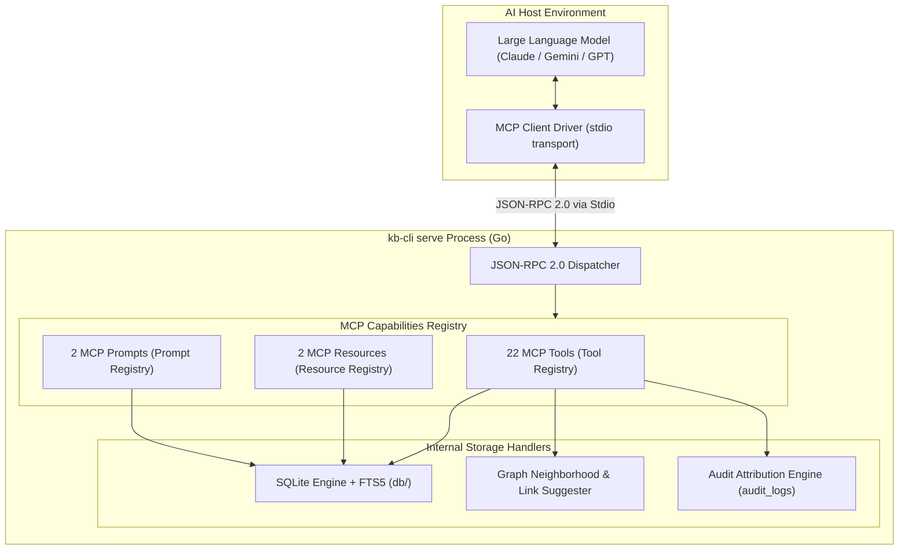

# 06. Model Context Protocol (MCP) Server Architecture

## 1. Overview & Human-AI Symbiosis

`kb-cli` is engineered from the ground up for **Human + AI Symbiosis**. It treats the personal knowledge base not merely as a passive document archive, but as a shared workspace where humans capture thoughts spontaneously and AI assistants autonomously organize, tag, link, and synthesize them.

To achieve this, `kb-cli` implements a native **Model Context Protocol (MCP)** server in [mcp/server.go](file:///e:/kb-cli/kb-cli/mcp/server.go) using the official `mark3labs/mcp-go` SDK.

By running:
```bash
kb serve
# or
kb serve mcp
```
the application starts a high-performance MCP server over standard input/output (`stdio`). Any MCP-compliant client—including Google Antigravity, Claude Desktop, Cursor, or Cline—can connect to `kb-cli` to perform graph analysis, link suggestion, note curation, and micro-log synthesis.

---

## 2. Server Architecture & Protocol Handshake



### 2.1 Initialization & Capabilities
During initialization, `NewServer()` negotiates the MCP protocol handshake:
- **Server Name:** `kb-knowledge-base`
- **Version:** `1.0.0`
- **Resource Capabilities:** Read-enabled (`WithResourceCapabilities(true, false)`)
- **Prompt Capabilities:** List- and Get-enabled (`WithPromptCapabilities(true)`)
- **Tool Capabilities:** Dynamic invocation of 22 tools with input schema validation

### 2.2 Stdio Transport & Process Sandboxing
Because the server communicates strictly over standard input and standard output (`server.ServeStdio(s)`):
1. No external network ports or TCP sockets are opened, eliminating network-based attack vectors.
2. Standard error (`stderr`) is reserved for operational logs, preventing corruptions of the JSON-RPC stream on `stdout`.
3. The server runs with the local user's filesystem permissions, operating directly on `~/.config/kb/kb.db`.

### 2.3 Non-Destructive Audit Attribution
Every write, edit, tag, link, or deletion performed through the MCP interface is audited. The engine inserts an entry into `audit_logs` capturing:
- `entity_type`: `'note'`, `'daily_log'`, or `'link'`
- `entity_id`: UUID of the affected entity
- `action`: `'create'`, `'update'`, `'delete'`, `'promote'`
- `changes_summary`: Human-readable summary of what changed
- `snapshot_json`: Full JSON representation of the entity state
- Attribution notes default to `"deleted by AI: <reason>"` or `"created by AI agent"`

---

## 3. Comprehensive Tool Reference (All 22 Tools)

The server exposes 22 specialized tools divided into logical domains:

### Domain 1: Note Retrieval & Search

#### 1. `list_notes`
Lists notes with optional multi-dimensional filtering. To preserve LLM context tokens, it returns compact summaries by default.
- **Parameters:**
  - `type` (string, optional): Filter by note type (`'note'`, `'todo'`, `'project'`, `'idea'`, `'decision'`, `'concept'`, `'til'`).
  - `status` (string, optional): Filter by status (`'active'`, `'raw'`, `'refined'`, `'in-progress'`, `'completed'`, `'archived'`).
  - `area` (string, optional): Filter by area (`'work'`, `'finance'`, `'personal'`).
  - `include_deleted` (boolean, optional, default: `false`): Whether to include soft-deleted notes.
  - `limit` (number, optional, default: `30`, max: `100`): Max notes to return.
  - `compact` (boolean, optional, default: `true`): Returns preview snippets instead of full bodies.

#### 2. `get_note`
Fetches complete details for a specific note.
- **Parameters:**
  - `id` (string, required): Full UUID or unique short ID prefix.
- **Returns:** Note ID, headline summary, full `note_flesh` Markdown body, type, status, area, importance, clarity, source, due date, timestamps, list of associated tags, and all incoming/outgoing graph links.

#### 3. `search_notes`
Executes full-text search across note summaries and bodies using SQLite FTS5.
- **Parameters:**
  - `query` (string, required): Search query or keywords.
  - `limit` (number, optional, default: `20`, max: `50`): Max results.
  - `compact` (boolean, optional, default: `true`): Returns compact summaries.

---

### Domain 2: Note Creation, Mutation & Lifecycle

#### 4. `create_note`
Creates a new note, task, project, idea, or architecture decision record.
- **Parameters:**
  - `note` (string, required): Headline summary (< 120 chars).
  - `content` (string, required): Detailed Markdown body (`note_flesh`).
  - `type` (string, optional, default: `'note'`): Note type.
  - `status` (string, optional, default: `'active'`): Note status.
  - `area` (string, optional): Functional area (e.g., `'work'`, `'health'`).
  - `due` (string, optional): Due date (relative formats like `'today'`, `'tomorrow'`, `'+3d'`, or `'2026-10-25'`).
  - `importance` (number, optional): Rating from 1 to 5.
  - `clarity` (number, optional): Rating from 1 to 5.
  - `source` (string, optional): Origin (e.g., `'Claude Desktop'`, `'Meeting'`).

#### 5. `update_note`
Modifies an existing note. Only specified fields are updated; omitted fields remain unchanged.
- **Parameters:**
  - `id` (string, required): Full UUID or short ID.
  - `note` (string, optional): New title/summary.
  - `content` (string, optional): New body content.
  - `type` (string, optional): New note type.
  - `status` (string, optional): New status.
  - `area` (string, optional): New area.
  - `due` (string, optional): New due date (pass `'clear'` to remove due date).
  - `importance` (number, optional): 1-5 rating.
  - `clarity` (number, optional): 1-5 rating.
  - `source` (string, optional): Updated source.

#### 6. `delete_note`
Performs a non-destructive soft-delete by recording `deleted_at` and attribution reason.
- **Parameters:**
  - `id` (string, required): Note ID.
  - `reason` (string, optional, default: `'deleted by AI'`): Attribution explanation.

#### 7. `restore_note`
Restores a previously soft-deleted note back to active state by clearing `deleted_at`.
- **Parameters:**
  - `id` (string, required): Full UUID or short ID of note to restore.

---

### Domain 3: Tags & Categorization

#### 8. `add_tag`
Attaches a tag to a note. If the tag does not exist, it is automatically created.
- **Parameters:**
  - `note_id` (string, required): Note ID.
  - `tag` (string, required): Tag string (e.g., `'tech/golang'`, `'project/kb'`).

#### 9. `remove_tag`
Removes a tag association from a note without deleting the tag itself.
- **Parameters:**
  - `note_id` (string, required): Note ID.
  - `tag` (string, required): Tag name to disassociate.

---

### Domain 4: Graph Relations & Knowledge Topology

#### 10. `link_notes`
Creates a directional semantic graph edge between two notes.
- **Parameters:**
  - `from_id` (string, required): Source note ID.
  - `to_id` (string, required): Target note ID.
  - `type` (string, optional, default: `'related_to'`): Relationship type:
    - `'related_to'`: General bidirectional association
    - `'part_of'`: Hierarchical component
    - `'inspired_by'`: Conceptual lineage
    - `'depends_on'`: Prerequisite task or architectural dependency
    - `'supports'`: Evidence, benchmark, or argument
    - `'contradicts'`: Counterpoint or conflicting hypothesis
    - `'about'`: Topical subject
    - `'created_by'`: Author or agent attribution

#### 11. `unlink_notes`
Soft-deletes or removes a directional link between two notes.
- **Parameters:**
  - `from_id` (string, required): Source note ID.
  - `to_id` (string, required): Target note ID.
  - `reason` (string, optional, default: `'unlinked by AI'`): Attribution reason.

#### 12. `get_knowledge_map`
Returns a bird's-eye topology of the entire knowledge base (~100-150 tokens) containing:
- Note counts grouped by area, type, and status
- Top 10 most frequently used tags
- Top hub notes (notes with the highest incoming/outgoing link counts)
- Current daily logging streak

#### 13. `get_graph_neighborhood`
Retrieves the bounded graph neighborhood around a focal note, including 1-hop incoming and outgoing connections, neighbor titles, relationship types, and shared tag clusters.
- **Parameters:**
  - `id` (string, required): Focal note ID.

#### 14. `suggest_links`
Intelligently analyzes a focal note or draft text against the knowledge base and returns candidate notes to link against, ranked with confidence scores and explainable match rationales.
- **Parameters:**
  - `note_id` (string, optional): Existing note ID to analyze.
  - `text` (string, optional): Raw draft text to analyze.
  - `limit` (number, optional, default: `5`): Max candidates to suggest.

#### 15. `get_orphans`
Finds active notes that have zero tags and zero incoming/outgoing links, allowing AI agents to systematically identify and connect isolated thoughts.
- **Parameters:**
  - `limit` (number, optional, default: `20`): Max orphans to return.
  - `compact` (boolean, optional, default: `true`): Returns compact summaries.

---

### Domain 5: Daily Micro-Logs & Triage

#### 16. `create_log`
Appends a timestamped micro-log to today's chronological stream.
- **Parameters:**
  - `content` (string, required): Log text entry.

#### 17. `list_daily_logs`
Lists daily stream micro-logs for today, a specific date, or a date range.
- **Parameters:**
  - `date` (string, optional): Target date (e.g., `'today'`, `'yesterday'`, `'2026-10-18'`).
  - `from` (string, optional): Start date (e.g., `'-7d'`, `'2026-10-01'`).
  - `to` (string, optional): End date.
  - `include_promoted` (boolean, optional, default: `true`): Include logs already promoted to notes.

#### 18. `promote_log`
Promotes a micro-log into a permanent active `models.Note` non-interactively.
- **Parameters:**
  - `log_id` (string, required): ID of the daily log.
  - `type` (string, optional, default: `'note'`): Promoted note type.
  - `status` (string, optional, default: `'raw'`): Promoted note status.

#### 19. `restore_log`
Restores a soft-deleted daily log back to active state.
- **Parameters:**
  - `id` (string, required): Daily log ID.

#### 20. `get_inbox`
Retrieves all unprocessed raw notes and unpromoted daily stream logs awaiting triage.
- **Parameters:**
  - `limit` (number, optional, default: `20`): Items per category.
  - `compact` (boolean, optional, default: `true`): Returns compact previews.

---

### Domain 6: History & Reversion

#### 21. `get_history`
Retrieves audit revision history and timeline for a note, log, or global activity.
- **Parameters:**
  - `id` (string, optional): Entity ID (if omitted, returns recent global activity).
  - `limit` (number, optional, default: `20`): Max revisions to return.

#### 22. `revert_note`
Reverts a note's state back to a previous point-in-time snapshot revision from `audit_logs`.
- **Parameters:**
  - `note_id` (string, required): ID of note to revert.
  - `revision_id` (string, required): ID of target audit log entry.

---

## 4. MCP Resources (`registerResources`)

Resources provide read-only data streams accessible via URI schemes:

### 1. `kb://today`
- **MIME Type:** `application/json`
- **Description:** Real-time stream of all daily logs recorded today.
- **Handler:** `handleResourceToday()` queries `db.GetDailyLogsForDate(time.Now(), true)`.

### 2. `kb://inbox`
- **MIME Type:** `application/json`
- **Description:** Combined JSON payload containing all raw unrefined notes and unpromoted logs awaiting triage.
- **Handler:** `handleResourceInbox()`.

---

## 5. MCP Prompts (`registerPrompts`)

Predefined prompt templates guide AI assistants in executing structured workflows:

### 1. `triage-inbox`
- **Description:** Instructs the assistant to inspect `kb://inbox`, analyze raw thoughts, and suggest structured note types, tags, areas, and links for each item.

### 2. `daily-summary`
- **Description:** Instructs the assistant to read `kb://today`, synthesize accomplishments, group completed tasks, and generate an executive end-of-day summary.

---

## 6. Client Configuration

### Claude Desktop (`claude_desktop_config.json`)
```json
{
  "mcpServers": {
    "kb": {
      "command": "kb",
      "args": ["serve"]
    }
  }
}
```

### Antigravity IDE (`.agents/mcp_config.json` or Global Config)
```json
{
  "mcpServers": {
    "kb": {
      "command": "kb",
      "args": ["serve"]
    }
  }
}
```
