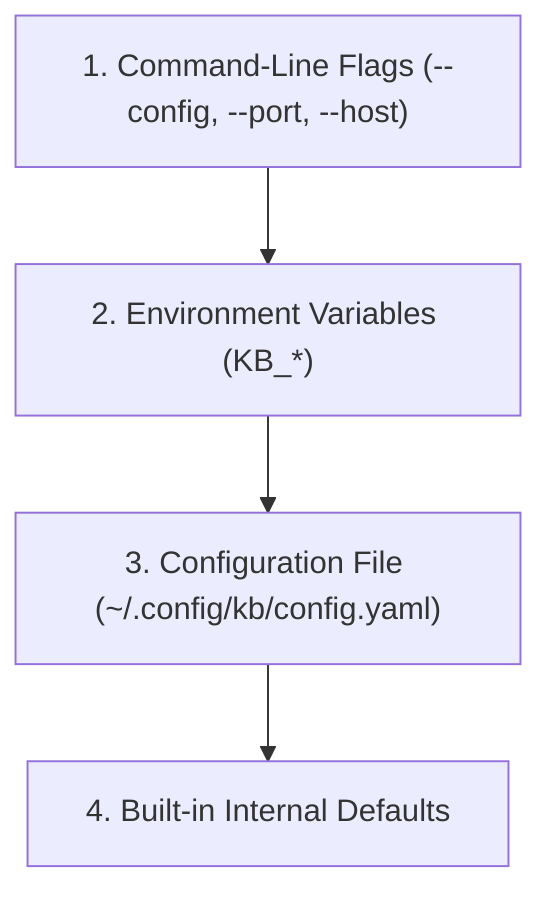
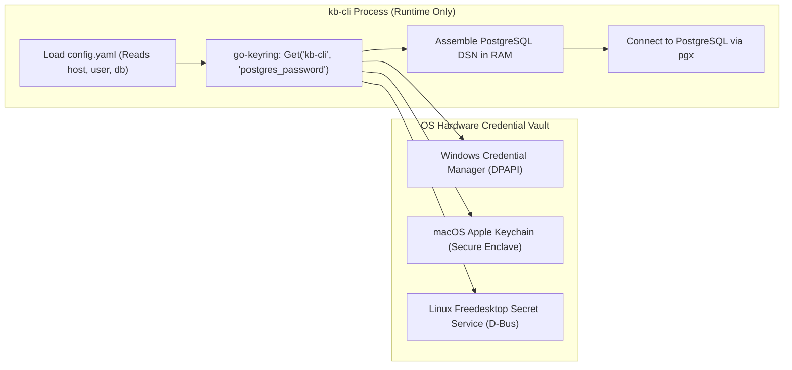

# 07. Configuration, Security & Secrets Management

## 1. Overview & Security Philosophy

`kb-cli` is architected with a strict security principle: **Your personal knowledge base and credentials must remain private, local-first, and protected against accidental credential leaks.**

To achieve this:
1. **Zero Cloud Leaks:** Your notes are stored locally in an embedded SQLite file. `kb-cli` sends zero telemetry, analytics, or background pings to external servers.
2. **Keyring Secrets Isolation:** Sensitive secrets—specifically remote PostgreSQL passwords—are **never stored in plaintext `config.yaml` files**. They are hardware-encrypted within your operating system's native credential store.
3. **Defense-in-Depth Configuration:** Configuration resolution follows a strict hierarchical precedence model via Viper.

---

## 2. Configuration Hierarchy & Resolution

`kb-cli` resolves configuration settings using a 4-tier precedence hierarchy (highest to lowest priority):



1. **Command-Line Flags:** Highest precedence (e.g., `--port 3000` overrides config file `server.port`).
2. **Environment Variables:** Prefixed with `KB_` (e.g., `KB_SERVER_PORT=3000`, `KB_BASE_PATH=/data/kb`).
3. **Configuration File (`config.yaml`):** Loaded from `~/.config/kb/config.yaml` (or custom path passed via `--config`).
4. **Built-in Defaults:** Fallback defaults defined in code.

---

## 3. Complete `config.yaml` Reference Specification

Below is an annotated reference specification containing every configuration key supported by `kb-cli`:

```yaml
# ==========================================
# KB-CLI SYSTEM CONFIGURATION REFERENCE
# File Path: ~/.config/kb/config.yaml
# ==========================================

# 1. Base Storage Directory
# Directory where kb.db and local data are stored.
# Supports ~ expansion for the user's home directory.
# Default: ~/.config/kb
base_path: "~/.config/kb"

# 2. Date & Formatting Preferences
# Standard Go date format string for display in tables and logs.
# Default: "2006-01-02"
date_format: "2006-01-02"

# 3. Default Capture Attributes
# Default type assigned when using zero-command capture (kb "thought").
# Options: note, todo, project, idea, decision, concept, til
default_type: "note"

# Default lifecycle status assigned to new notes.
# Options: raw, refined, in-progress, completed, archived
default_status: "raw"

# 4. Web Fuzzy Finder HTTP Server Settings
server:
  # Network interface to bind to (use 127.0.0.1 for local only, 0.0.0.0 for LAN access)
  host: "127.0.0.1"
  # Port number for the HTTP server
  port: 8080
  # Automatically open default browser when starting server via 'kb serve http'
  open_browser: false
  # Optional TLS certificate and key files for HTTPS
  # Enables PWA offline installation over local networks
  tls_cert: ""
  tls_key: ""

# 5. Remote PostgreSQL Synchronization
remote:
  # Enable or disable remote sync operations
  enabled: true
  # Database driver provider (currently 'postgres')
  provider: "postgres"
  # Remote host address (e.g. Supabase, Neon, AWS RDS, or localhost)
  host: "db.example.com"
  # PostgreSQL port (standard: 5432)
  port: 5432
  # Database user
  user: "kb_admin"
  # Database name
  database: "kb_knowledge_base"
  # SSL Mode: disable, require, verify-ca, verify-full
  # Recommended: require
  sslmode: "require"
  # Connection pool tuning
  max_open_conns: 5
  max_idle_conns: 2
  conn_max_lifetime: "5m"

# 6. Web Authentication Settings (Optional)
auth:
  # When true, accessing the web UI requires PIN authentication
  enabled: false
  # Salted hash of the web PIN (never store plain PINs)
  pin_hash: ""
```

---

## 4. Hardware-Encrypted OS Keyring Architecture

Storing database credentials in plaintext dotfiles (`config.yaml`) poses significant security risks:
- Accidental commits to public Git repositories (`.dotfiles`).
- Read exposure to other unprivileged processes or backup scripts.
- Terminal shell history leaks.

To eliminate this vulnerability, `kb-cli` integrates with the host operating system's native secure credential manager via the `zalando/go-keyring` library:



### 4.1 Platform Implementations
- **Windows:** Interacts with **Windows Credential Manager** using DPAPI (Data Protection API) tied to the logged-in Windows user account.
- **macOS:** Interacts with the **Apple Keychain**, leveraging macOS hardware encryption and access control lists.
- **Linux:** Communicates over D-Bus with the **Freedesktop Secret Service API** (GNOME Keyring or KDE KWallet).

### 4.2 Setting & Managing Secrets via CLI

#### Secure Password Entry
When setting a secret:
```bash
kb config set-secret postgres_password
```
The CLI prompts:
```text
Enter secret value for postgres_password: [masked input]
Confirm secret value: [masked input]
✓ Secret 'postgres_password' saved to OS Keyring successfully.
```
Input characters are masked in the terminal to prevent shoulder-surfing. The password is sent directly to the OS Keyring and is never printed or saved to any file.

#### Inspecting & Deleting Secrets
```bash
# Verify that a secret is stored (value is masked for safety)
kb config get postgres_password

# Delete a stored secret from the OS Keyring
kb config delete --secret postgres_password
kb config rm --secret postgres_password
```

---

## 5. Local Storage Path Resolution (`app/app.go`)

At application boot, [app/app.go](file:///e:/kb-cli/kb-cli/app/app.go) executes the following path resolution logic:

1. **Query Viper:** Queries `base_path` from Viper configuration.
2. **Tilde Expansion:** If `base_path` starts with `~`, it calls `utils.ExpandHome()` to replace `~` with the user's absolute home directory.
3. **Default Fallback:** If `base_path` is empty or unset, it determines the user's home directory via `os.UserHomeDir()` and constructs:
   - `filepath.Join(home, ".config", "kb")`
4. **Directory Creation:** Calls `os.MkdirAll(basePath, 0755)` to guarantee the parent directory exists.
5. **Database Initialization:** Appends `"kb.db"` to `basePath` and passes the full path to `db.InitDB()`.

---

## 6. TLS & HTTPS Configuration for Web PWA

The embedded web server supports TLS certificates to enable secure HTTPS access over local home or office networks. 

### Why HTTPS is Required for PWAs
Modern mobile operating systems (iOS Safari and Android Chrome) **require a secure context (HTTPS)** to allow Service Worker registration and native PWA installation if the app is accessed from any address other than `localhost`.

### Running with TLS
```bash
kb serve http --tls-cert /path/to/cert.pem --tls-key /path/to/key.pem --host 0.0.0.0 --port 8443
```
When TLS flags are provided, [server/server.go](file:///e:/kb-cli/kb-cli/server/server.go) launches `http.ListenAndServeTLS` instead of standard HTTP, allowing secure, offline-capable mobile access across your private Wi-Fi network.
