# 08. Audit & Revision History System

## 1. System Vision & Architecture Philosophy

In a local-first personal knowledge base and second brain, **data integrity, safety, and accountability are paramount**. Because `kb-cli` can be concurrently modified across multiple operational boundaries—such as fast terminal commands, the embedded Web SPA, background sync with remote PostgreSQL, and autonomous AI agents connected via the Model Context Protocol (MCP)—users must never fear losing thoughts to accidental edits, automated agent updates, or deletion.

The **Audit & Revision History System** provides an immutable, transparent, and non-destructive safety net across all entities in the database.

### Core Architectural Pillars
1. **Append-Only Immutable History:** Audit logs are never updated or overwritten. Every state transition is recorded as a new, timestamped entry in the `audit_logs` table.
2. **Point-in-Time State Snapshots:** Every mutation captures a complete JSON snapshot (`snapshot_json`) of the entity's exact state prior to or after modification, enabling lossless point-in-time recovery.
3. **Automated Granular Diff Engine:** The system compares pre- and post-mutation models to generate concise, human-readable summaries (e.g. `title updated`, `status: raw -> active`, `body edited (+140 chars)`, `due: 2026-10-20`).
4. **Atomic Time-Travel Reversion:** Users or AI agents can instantly revert any note back to any historical snapshot. Reversions execute inside an atomic SQLite transaction, synchronizing the primary table, the SQLite FTS5 search index, and appending a new `restored` audit event.
5. **AI Attribution & Non-Destructive Tombstoning:** Accidental deletions never drop rows; they record a `deleted` action with human or AI attribution reasons (`"deleted by AI agent"`, `"deleted by user"`).

---

## 2. Audit Lifecycle & Event Topology

```mermaid
sequenceDiagram
    participant Client as User (CLI / Web) or AI (MCP)
    participant Core as Note Service (db/notes.go)
    participant Diff as Diff Engine (db.ComputeNoteDiffSummary)
    participant DB as SQLite Engine (WAL Mode)
    participant Sync as PostgreSQL Sync Engine

    Client->>Core: Update Note (Headline, Flesh, Status)
    Core->>DB: Fetch Current State (oldNote)
    Core->>Diff: Compare oldNote vs newNote
    Diff-->>Core: "status: raw -> active, body edited (+85 chars)"
    
    rect rgb(20, 25, 35)
        Note over Core,DB: Atomic Transaction (db.Begin)
        Core->>DB: UPDATE notes SET ... WHERE id = ?
        Core->>DB: UPDATE notes_fts (FTS5 Synchronization)
        Core->>DB: INSERT INTO audit_logs (id, entity_type, action, changes_summary, snapshot_json, created_at)
        Core->>DB: COMMIT
    end

    opt Remote Cloud Replication
        Sync->>DB: Query audit_logs (created_at > last_synced_at)
        Sync->>RemotePG: Replicate audit trail (ON CONFLICT DO NOTHING)
    end
```



---

## 3. Database Schema & Models

### 3.1 SQLite & PostgreSQL `audit_logs` Schema
Defined in [db/schema.sql](file:///e:/kb-cli/kb-cli/db/schema.sql) and replicated in [sync/postgres.go](file:///e:/kb-cli/kb-cli/sync/postgres.go):

```sql
CREATE TABLE IF NOT EXISTS audit_logs (
    id              TEXT PRIMARY KEY,
    entity_type     TEXT NOT NULL,               -- 'note' or 'daily_log'
    entity_id       TEXT NOT NULL,               -- Foreign ID of target entity
    action          TEXT NOT NULL,               -- 'created' | 'updated' | 'deleted' | 'restored' | 'promoted'
    changes_summary TEXT,                        -- Human-readable change summary
    snapshot_json   TEXT,                        -- Full point-in-time JSON payload
    created_at      TIMESTAMP NOT NULL DEFAULT CURRENT_TIMESTAMP
);

-- Fast entity revision timeline lookup (ordered reverse chronologically)
CREATE INDEX IF NOT EXISTS idx_audit_entity ON audit_logs(entity_type, entity_id, created_at DESC);

-- Fast global activity stream lookup
CREATE INDEX IF NOT EXISTS idx_audit_created_at ON audit_logs(created_at DESC);
```

### 3.2 Go Domain Models ([models/audit.go](file:///e:/kb-cli/kb-cli/models/audit.go))

```go
type AuditAction string

const (
    ActionCreated  AuditAction = "created"
    ActionUpdated  AuditAction = "updated"
    ActionDeleted  AuditAction = "deleted"
    ActionRestored AuditAction = "restored"
    ActionPromoted AuditAction = "promoted"
)

type AuditEntry struct {
    ID             string      `json:"id"`
    EntityType     string      `json:"entity_type"` // "note" | "daily_log"
    EntityID       string      `json:"entity_id"`
    Action         AuditAction `json:"action"`
    ChangesSummary string      `json:"changes_summary"`
    SnapshotJSON   string      `json:"snapshot_json"`
    CreatedAt      time.Time   `json:"created_at"`
}
```

---

## 4. The Diff Computation Engine

When an entity is updated, [db/audit.go](file:///e:/kb-cli/kb-cli/db/audit.go#L44-L118) executes `ComputeNoteDiffSummary(oldNote, newNote)`. This produces a compact, natural-language string summarizing all altered fields:

| Field Changed | Diff Rule / Output Format | Example Output |
| :--- | :--- | :--- |
| **Headline (`note`)** | Short string diff or `"title updated"` | `title: "Old title" -> "New title"` |
| **Status (`status`)** | State machine transition | `status: raw -> active` |
| **Type (`type`)** | Concept re-classification | `type: note -> project` |
| **Area (`area`)** | PARA category assignment | `area: none -> Work` |
| **Due Date (`target_date_time`)** | Timestamp addition, change, or clear | `due: 2026-10-20 -> 2026-10-25` |
| **Flesh (`note_flesh`)** | Character delta quantification | `body added (+240 chars)` or `body edited (-45 chars)` |
| **Importance / Clarity** | Priority & triage rating shift | `importance: 2 -> 5` |

```go
// Example: ComputeNoteDiffSummary logic snippet
if oldNote.Status != newNote.Status && newNote.Status != "" {
    changes = append(changes, fmt.Sprintf("status: %s -> %s", oldNote.Status, newNote.Status))
}
if oldNote.NoteFlesh != newNote.NoteFlesh {
    charDiff := len(newNote.NoteFlesh) - len(oldNote.NoteFlesh)
    if charDiff > 0 {
        changes = append(changes, fmt.Sprintf("body edited (+%d chars)", charDiff))
    }
}
```

---

## 5. Time Travel & Atomic Reversion Engine

The `RevertNoteToSnapshot` function in [db/audit.go](file:///e:/kb-cli/kb-cli/db/audit.go#L286-L350) restores a note to any historical point in time.

### Transactional Reversion Steps
1. **JSON Decoding:** Parses the stored `snapshot_json` into a `models.Note` struct.
2. **UUID Resolution:** Verifies and validates that the revision belongs to the designated target note.
3. **Transactional Update:**
   - Overwrites all mutable attributes (`note`, `note_flesh`, `type`, `status`, `area`, `importance`, `clarity`, `source`, `target_date_time`) in `notes`.
   - Advances `updated_at` to the current timestamp so sync engines replicate the rollback.
4. **FTS5 Synchronization:** Deletes the old index entry in `notes_fts` and re-inserts the restored headline and flesh to keep full-text search 100% synchronized.
5. **Restoration Audit Trail:** Appends a new audit record with action `ActionRestored` and a summary noting the point-in-time timestamp:
   ```text
   reverted to snapshot 2026-10-18 10:15
   ```
6. **Atomic Commit:** Commits the transaction or rolls back completely if any query fails.

---

## 6. CLI Command Workflows & Usage

The CLI exposes the audit subsystem via the `kb history` command (aliased as `kb audit`, `kb revisions`, and `kb changelog` in [cmd/history.go](file:///e:/kb-cli/kb-cli/cmd/history.go)).

### 6.1 View Recent Global Audit Activity
```bash
# View last 30 mutations across all notes and daily logs
kb history

# Or using the direct alias with custom limit:
kb audit --limit 50
```

### 6.2 View Revision Timeline for a Specific Note
```bash
kb history 43d1d84
```
Outputs a formatted table showing revision ID prefixes, actions, summaries, and relative times:
```text
=== History for Note [43d1d84] "RMP Registration Attestation" ===
╭─────────┬──────────┬───────────────────────────────────────────────────┬──────────────────╮
│ REV ID  │ ACTION   │ CHANGES SUMMARY                                   │ CREATED AT       │
├─────────┼──────────┼───────────────────────────────────────────────────┼──────────────────┤
│ 8a2f1c0 │ updated  │ status: active -> completed                       │ 2026-10-18 11:15 │
│ b7e40a1 │ updated  │ body edited (+120 chars), area: none -> Work      │ 2026-10-17 16:40 │
│ c3d98f2 │ created  │ initial capture                                   │ 2026-10-12 17:06 │
╰─────────┴──────────┴───────────────────────────────────────────────────┴──────────────────╯
```

### 6.3 Inspect Snapshot Diffs
```bash
# Inspect the most recent revision diff:
kb history diff 43d1d84

# Inspect a specific historical revision:
kb history diff 43d1d84 b7e40a1
```

### 6.4 Roll Back / Revert to a Historical Revision
```bash
kb history revert 43d1d84 b7e40a1
```
*Output:*
```text
✔ Reverted note [43d1d84] to revision [b7e40a1] (2026-10-17 16:40)
  Title:  RMP Registration Attestation
  Status: active | Type: note
```

---

## 7. Multi-Interface Integration

### 7.1 Web Interface Integration
In the embedded Single-Page Application:
- `GET /api/notes/{id}` automatically includes the note's revision timeline in the JSON payload.
- The bottom of the preview pane displays an interactive **Revision History Drawer** with action badges (`created`, `updated`, `deleted`, `restored`), human-readable diff pills, and timestamps.

### 7.2 Model Context Protocol (MCP) AI Integration
Autonomous AI agents interact with the audit engine via native tools:
- `get_audit_history`: Lets agents verify what changes were made previously before making edits.
- `revert_note`: Allows agents or users to request rollbacks if an AI-generated modification was unsatisfactory.
- **Attribution Tagging:** When mutations occur through MCP, the action reason is attributed as `"updated by AI agent"` or `"deleted by AI agent"`, maintaining total transparency.

### 7.3 PostgreSQL Cloud Replication
The synchronization engine ([sync/postgres.go](file:///e:/kb-cli/kb-cli/sync/postgres.go)) treats audit logs as first-class replicated records:
- Pulls remote audit records using timestamp watermarking (`created_at > last_synced_at`).
- Pushes local audit entries in batches of 50.
- Uses `ON CONFLICT (id) DO NOTHING` because audit IDs are globally unique UUIDs and audit logs are strictly immutable.
