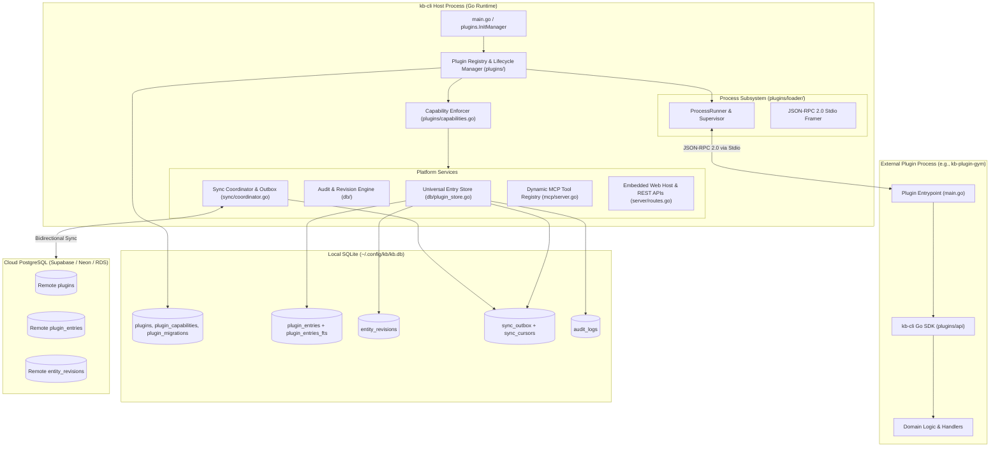

# 09. Multi-Plugin Platform Architecture

## 1. Overview & Architectural Vision

`kb-cli` is designed as an extensible, multi-plugin platform. While the core application focuses on atomic thought capture, micro-logging, and knowledge graphs, specialized workflows (such as gym/workout tracking, personal finance, habit tracking, or bookmarks) are implemented as **independent, modular plugins**.

To ensure that the core knowledge base remains rock-solid, crash-resistant, and secure, plugins operate under five foundational principles:

1. **Process Isolation:** Plugins run as external standalone binaries communicating with the `kb-cli` host process over standard input/output (`stdio`) via a robust JSON-RPC 2.0 framing transport. A crash or memory leak in a plugin cannot crash `kb-cli`.
2. **Capability-Based Security:** Plugins declare required capabilities in their manifest. The user explicitly reviews, grants, or revokes capabilities (such as `storage.entries`, `audit.write`, `secrets`, or `network`).
3. **Universal Storage & FTS5:** Plugins have access to a managed polymorphic document store (`plugin_entries`) with typed projection columns, full SQLite FTS5 keyword indexing, cross-entity tagging, and semantic graph linking.
4. **Unified Revision History & Auditing:** Plugin data mutations automatically generate immutable revision snapshots in `entity_revisions` and write structured audit records into `audit_logs`.
5. **Transactional Outbox Cloud Sync:** Plugin mutations are enqueued into a local `sync_outbox` table, enabling transactional synchronization with remote PostgreSQL databases via pluggable `SyncAdapter` implementations.

---

## 2. Multi-Plugin Architecture Topology



---

## 3. Public Go SDK (`plugins/api/`)

The public SDK defines the contract between `kb-cli` and external plugin binaries.

### 3.1 Manifest & Capabilities

Every plugin exposes a static manifest declaring its identity, version, dependencies, capabilities, subcommands, routes, and MCP tools:

```go
type Manifest struct {
    ID           string             `json:"id"`
    Name         string             `json:"name"`
    Version      string             `json:"version"`
    APIVersion   string             `json:"api_version"`
    Description  string             `json:"description"`
    Author       string             `json:"author"`
    Capabilities []Capability       `json:"capabilities"`
    Commands     []CommandSpec      `json:"commands,omitempty"`
    HTTPRoutes   []HTTPRouteSpec    `json:"http_routes,omitempty"`
    MCPTools     []MCPToolSpec      `json:"mcp_tools,omitempty"`
    Migrations   []MigrationSpec    `json:"migrations,omitempty"`
}
```

#### Standard Capability Tokens
| Capability Constant | String Identifier | Description |
| :--- | :--- | :--- |
| `CapStorageEntries` | `"storage.entries"` | Access to polymorphic `plugin_entries` CRUD, queries, and FTS5 search. |
| `CapStorageSQL` | `"storage.sql"` | Execution of custom DDL/DML and dedicated plugin tables. |
| `CapAuditWrite` | `"audit.write"` | Writing structured audit trail entries into `audit_logs`. |
| `CapSecrets` | `"secrets"` | Reading and writing sensitive credentials to the OS hardware keyring. |
| `CapNetwork` | `"network"` | Making outbound network requests from the plugin process. |
| `CapSyncAdapter` | `"sync.adapter"` | Registering custom replication adapters and conflict handlers with `SyncCoordinator`. |

### 3.2 Universal Storage API (`EntryStore`)

The SDK provides typed CRUD operations over `plugin_entries`:

```go
type Entry struct {
    ID            string          `json:"id"`
    PluginID      string          `json:"plugin_id"`
    EntityType    string          `json:"entity_type"`
    SchemaVersion int             `json:"schema_version"`
    ParentID      *string         `json:"parent_id,omitempty"`
    Status        string          `json:"status"`
    OccurredAt    *time.Time      `json:"occurred_at,omitempty"`
    EntryDate     string          `json:"entry_date,omitempty"` // YYYY-MM-DD
    NumVal        float64         `json:"num_val"`
    SearchText    string          `json:"search_text"`
    Data          json.RawMessage `json:"data"`
    CreatedAt     time.Time       `json:"created_at"`
    UpdatedAt     time.Time       `json:"updated_at"`
    DeletedAt     *time.Time      `json:"deleted_at,omitempty"`
    DeletedNote   *string         `json:"deleted_note,omitempty"`
    Revision      int64           `json:"revision"`
}

type EntryStore interface {
    Get(ctx context.Context, id string) (*Entry, error)
    List(ctx context.Context, filter EntryFilter) ([]*Entry, error)
    Create(ctx context.Context, entry *Entry) error
    Update(ctx context.Context, entry *Entry) error
    Delete(ctx context.Context, id string, note string) error
    Search(ctx context.Context, query string, limit int) ([]*Entry, error)
}
```

### 3.3 Synchronization Adapter API (`SyncAdapter`)

External plugins can register custom conflict resolution rules and serialization hooks:

```go
type SyncAdapter interface {
    PluginID() string
    EntityType() string
    ConflictPolicy() ConflictPolicy
    Serialize(entry *Entry) ([]byte, error)
    Deserialize(data []byte) (*Entry, error)
    ResolveConflict(local, remote *Change) (*Change, error)
}
```

---

## 4. Host Runtime & Process Protocol (`plugins/loader/`)

External plugin binaries communicate with `kb-cli` using newline-delimited JSON-RPC 2.0 messages over standard I/O.

### 4.1 Process Spawning & Environment Sanitization
When launching a plugin binary via `ProcessRunner`:
1. The host sanitizes the execution environment, retaining system essentials (`PATH`, `HOME`, `USERPROFILE`, `TMP`) while scrubbing sensitive master environment variables.
2. The host passes scoped configuration variables (`KB_PLUGIN_ID`, `KB_CONFIG_DIR`, `KB_API_VERSION`).
3. Standard error (`stderr`) is redirected to the host log stream, allowing plugins to log diagnostics without corrupting the standard I/O JSON-RPC protocol channel.

### 4.2 Protocol Handshake & Lifecycle
1. **`initialize` (Host -> Plugin):** The host sends an initialization request containing host capabilities and API version.
2. **`initialize_response` (Plugin -> Host):** The plugin returns its full `Manifest`.
3. **Capability Verification:** The host verifies that all requested capabilities have been granted in `plugin_capabilities`. If missing, privileged calls are rejected with `ErrCapabilityNotGranted`.
4. **Command & MCP Tool Registration:** The host mounts plugin subcommands under `kb <plugin_id>` and dynamically registers plugin tools in the MCP server.
5. **Execution Proxying:**
   - CLI: `kb <plugin> <cmd>` -> JSON-RPC `invoke_command` -> Plugin handler -> Terminal output.
   - MCP: Agent tool call -> JSON-RPC `invoke_tool` -> Plugin handler -> Agent tool result.

---

## 5. Universal Storage Engine & Database Schema

The universal storage engine in [db/plugin_store.go](file:///e:/kb-cli/kb-cli/db/plugin_store.go) provides robust, index-optimized data storage for all plugins.

### 5.1 Polymorphic `plugin_entries` Table
```sql
CREATE TABLE IF NOT EXISTS plugin_entries (
    id              TEXT PRIMARY KEY,
    plugin_id       TEXT NOT NULL,
    entity_type     TEXT NOT NULL,
    schema_version  INTEGER NOT NULL DEFAULT 1,
    parent_id       TEXT,
    status          TEXT NOT NULL DEFAULT 'active',
    occurred_at     DATETIME,
    entry_date      TEXT,                           -- 'YYYY-MM-DD' for date indexing
    num_val         REAL DEFAULT 0,                 -- indexed numeric (weight, cost, duration)
    search_text     TEXT NOT NULL DEFAULT '',       -- searchable plain text
    data            TEXT NOT NULL DEFAULT '{}',     -- domain JSON payload
    created_at      DATETIME NOT NULL,
    updated_at      DATETIME NOT NULL,
    deleted_at      DATETIME,
    deleted_note    TEXT,
    revision        INTEGER NOT NULL DEFAULT 1,
    UNIQUE (plugin_id, id),
    FOREIGN KEY (plugin_id) REFERENCES plugins(plugin_id)
);
```

### 5.2 SQLite FTS5 Full-Text Search
A virtual table is synchronized with every mutation:
```sql
CREATE VIRTUAL TABLE IF NOT EXISTS plugin_entries_fts USING fts5(
    entry_id UNINDEXED,
    plugin_id UNINDEXED,
    entity_type UNINDEXED,
    search_text,
    tokenize = 'unicode61'
);
```

### 5.3 Immutable Entity Revisions
On every create, update, or soft-delete, a point-in-time JSON snapshot is recorded:
```sql
CREATE TABLE IF NOT EXISTS entity_revisions (
    revision_id     TEXT PRIMARY KEY,
    plugin_id       TEXT NOT NULL,
    entity_type     TEXT NOT NULL,
    entity_id       TEXT NOT NULL,
    revision        INTEGER NOT NULL,
    schema_version  INTEGER NOT NULL,
    snapshot_json   TEXT NOT NULL,
    created_at      DATETIME NOT NULL,
    UNIQUE (plugin_id, entity_type, entity_id, revision)
);
```

### 5.4 Cross-Entity Tags & Links
Plugins can associate entries with global tags and link entities to notes or other plugins:
```sql
CREATE TABLE IF NOT EXISTS entity_tags (
    plugin_id       TEXT NOT NULL,
    entity_type     TEXT NOT NULL,
    entity_id       TEXT NOT NULL,
    tag_id          TEXT NOT NULL,
    PRIMARY KEY (plugin_id, entity_type, entity_id, tag_id),
    FOREIGN KEY (tag_id) REFERENCES tags(id) ON DELETE CASCADE
);

CREATE TABLE IF NOT EXISTS entity_links (
    link_id         TEXT PRIMARY KEY,
    source_plugin   TEXT NOT NULL,
    source_type     TEXT NOT NULL,
    source_id       TEXT NOT NULL,
    target_plugin   TEXT NOT NULL,
    target_type     TEXT NOT NULL,
    target_id       TEXT NOT NULL,
    relation_type   TEXT NOT NULL DEFAULT 'related_to',
    created_at      DATETIME NOT NULL,
    UNIQUE (source_plugin, source_type, source_id, target_plugin, target_type, target_id, relation_type)
);
```

---

## 6. Transactional Outbox & Cloud Synchronization

Plugin mutations participate in bidirectional cloud synchronization via a Transactional Outbox pattern implemented in [db/outbox.go](file:///e:/kb-cli/kb-cli/db/outbox.go) and [sync/coordinator.go](file:///e:/kb-cli/kb-cli/sync/coordinator.go).

### 6.1 Transactional Outbox Pattern
Every write to `plugin_entries` atomically inserts a row into `sync_outbox` in the same SQLite transaction:
```sql
CREATE TABLE IF NOT EXISTS sync_outbox (
    sequence        INTEGER PRIMARY KEY AUTOINCREMENT,
    change_id       TEXT NOT NULL UNIQUE,
    plugin_id       TEXT NOT NULL,
    entity_type     TEXT NOT NULL,
    entity_id       TEXT NOT NULL,
    operation       TEXT NOT NULL CHECK (operation IN ('upsert', 'tombstone')),
    base_version    INTEGER NOT NULL DEFAULT 0,
    entity_version  INTEGER NOT NULL,
    schema_version  INTEGER NOT NULL,
    payload_json    TEXT NOT NULL,
    created_at      DATETIME NOT NULL,
    attempts        INTEGER NOT NULL DEFAULT 0,
    last_error      TEXT,
    acknowledged_at DATETIME
);
```

### 6.2 Reconciliation Loop
1. **Push:** `SyncCoordinator` fetches unacknowledged outbox items (`acknowledged_at IS NULL`), translates them into remote PostgreSQL upserts, and marks them acknowledged upon remote commit.
2. **Pull:** `SyncCoordinator` queries remote PostgreSQL tables for changes updated after the stored cursor in `sync_cursors`.
3. **Reconciliation:** Incoming remote changes are passed to the registered `SyncAdapter` for conflict resolution (defaulting to Last-Write-Wins based on `updated_at`).

---

## 7. Web UI & Client Host Integration

The embedded web interface includes a client-side plugin host (`server/web/js/plugin-host.js`) that allows plugins to surface views and UI extensions:

1. **REST API Endpoints:**
   - `GET /api/plugins`: Returns list of installed plugins, status, and metadata.
   - `GET /api/plugins/{id}/entries`: Lists entries with filtering by `entity_type`, `date`, `status`, etc.
   - `POST /api/plugins/{id}/entries`: Creates a new universal entry.
   - `GET /api/plugins/{id}/entries/{entryId}`: Fetches a single entry.
   - `PUT /api/plugins/{id}/entries/{entryId}`: Updates an entry.
   - `DELETE /api/plugins/{id}/entries/{entryId}`: Soft-deletes an entry.
2. **Client Hash Routing:** Navigation to `#/plugins/:pluginId` automatically activates the registered plugin view container.
3. **Security Sandboxing:** Plugin web views are loaded into sandboxed iframe containers or isolated DOM namespaces to prevent interference with core search and navigation.

---

## 8. CLI Management (`kb plugin`)

The CLI provides complete lifecycle management for plugins:

```bash
# List all discovered and installed plugins
kb plugin list

# Install an external plugin binary
kb plugin install ./bin/kb-plugin-gym

# Enable or disable a plugin
kb plugin enable gym
kb plugin disable gym

# Grant or revoke granular capabilities
kb plugin grant gym storage.entries
kb plugin grant gym audit.write
kb plugin revoke gym secrets

# Run health check and diagnostic inspection
kb plugin doctor gym
```
