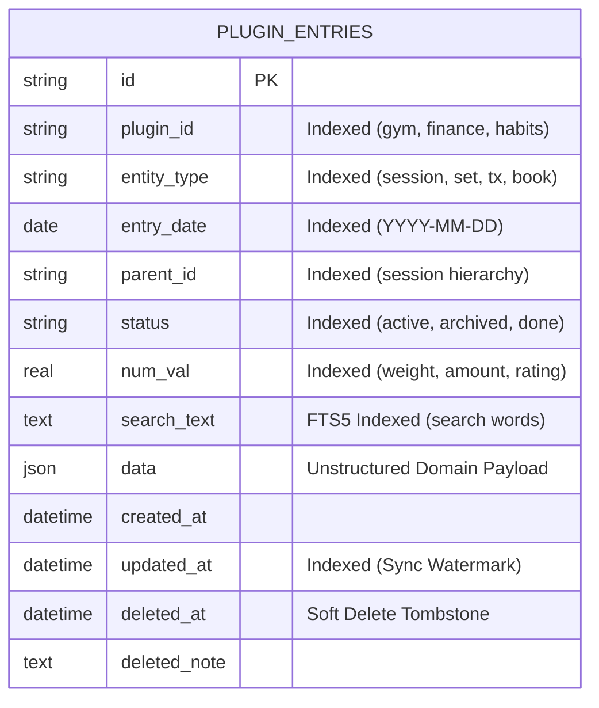

# 01. Universal Storage & Scalability Architecture (Proposal)

> [!NOTE]
> This document is an architecture proposal for the future plugin system and is not yet part of the active database schema.

## 1. Scalability Design Goals

A multi-plugin personal data system faces a dual challenge:
1. **Heterogeneity:** Different plugins have completely different data shapes (time-series gym sets, financial transactions, habit streaks, book reviews).
2. **Performance at Scale:** Filtering or aggregating one plugin’s data must never degrade as the total database grows to hundreds of thousands of rows over years of use.

The naive approach—storing arbitrary data in an unindexed `data JSON` column—fails at scale because queries requiring aggregation (`SUM(expenses)`, `MAX(weight)`) or range filters require deserializing every JSON blob via a full-table scan.

The solution is the **Universal Envelope + Indexed Facets** pattern.

---

## 2. The Universal Envelope + Indexed Facets Pattern

Instead of creating separate database tables for every plugin or relying on raw JSON text scans, the proposed storage engine uses a single, strongly-typed envelope equipped with **indexed query facets**:



### Facet Mapping Across Diverse Plugins

| Column | Gym Plugin | Finance Plugin | Habits Plugin | Reading Plugin |
| :--- | :--- | :--- | :--- | :--- |
| `plugin_id` | `'gym'` | `'finance'` | `'habits'` | `'reading'` |
| `entity_type` | `'set'` or `'session'` | `'expense'` or `'income'` | `'check'` | `'book'` or `'session'` |
| `entry_date` | Date of workout | Date of transaction | Date completed | Date logged |
| `parent_id` | Session ID for the set | Account ID / Report ID | Habit ID | Book ID for reading log |
| `status` | `'active'` | `'cleared'` / `'pending'`| `'done'` / `'skipped'` | `'reading'` / `'finished'` |
| `num_val` | Set weight (e.g., `70.0`) | Cost (e.g., `45.50`) | Score (`1.0`) | Rating / Page count |
| `search_text` | `"bench press chest"` | `"groceries supermarket"`| `"morning run 5k"` | `"atomic habits clear"` |
| `data` (JSON) | `{"reps": 8, "rpe": 8}` | `{"category": "food"}` | `{"streak": 14}` | `{"isbn": "...", "pages": 320}` |

---

## 3. Proposed Database Schemas

### 3.1 Local SQLite DDL

```sql
-- 1. Universal Plugin Entries Table
CREATE TABLE IF NOT EXISTS plugin_entries (
    id TEXT PRIMARY KEY,
    plugin_id TEXT NOT NULL,
    entity_type TEXT NOT NULL,
    entry_date DATE NOT NULL,
    parent_id TEXT,
    status TEXT DEFAULT 'active',
    num_val REAL DEFAULT 0,
    search_text TEXT DEFAULT '',
    data JSON NOT NULL,
    created_at DATETIME NOT NULL,
    updated_at DATETIME NOT NULL,
    deleted_at DATETIME,
    deleted_note TEXT
);

-- 2. Domain & Date Range Index (Retrieving a day's workout or month's logs)
CREATE INDEX IF NOT EXISTS idx_entries_plugin_date 
    ON plugin_entries(plugin_id, entry_date DESC);

-- 3. Entity Type Filtering (Retrieving all sets, all expenses, etc.)
CREATE INDEX IF NOT EXISTS idx_entries_plugin_entity 
    ON plugin_entries(plugin_id, entity_type, entry_date DESC);

-- 4. Hierarchy / Parent Traversal (All sets in a workout session)
CREATE INDEX IF NOT EXISTS idx_entries_parent 
    ON plugin_entries(parent_id) WHERE parent_id IS NOT NULL;

-- 5. Fast Numeric Aggregation (Personal records, expense sums, ratings)
CREATE INDEX IF NOT EXISTS idx_entries_numeric 
    ON plugin_entries(plugin_id, entity_type, num_val);

-- 6. Incremental Sync Watermark Index
CREATE INDEX IF NOT EXISTS idx_entries_updated 
    ON plugin_entries(updated_at);

-- 7. Full-Text Search Virtual Table (FTS5)
CREATE VIRTUAL TABLE IF NOT EXISTS plugin_entries_fts USING fts5(
    search_text,
    content='plugin_entries',
    content_rowid='rowid'
);
```

### 3.2 Remote PostgreSQL DDL

```sql
CREATE TABLE IF NOT EXISTS plugin_entries (
    id VARCHAR(64) PRIMARY KEY,
    plugin_id VARCHAR(64) NOT NULL,
    entity_type VARCHAR(64) NOT NULL,
    entry_date DATE NOT NULL,
    parent_id VARCHAR(64),
    status VARCHAR(64) DEFAULT 'active',
    num_val DOUBLE PRECISION DEFAULT 0,
    search_text TEXT DEFAULT '',
    data JSONB NOT NULL,
    created_at TIMESTAMPTZ DEFAULT NOW(),
    updated_at TIMESTAMPTZ DEFAULT NOW(),
    deleted_at TIMESTAMPTZ,
    deleted_note TEXT
);

CREATE INDEX IF NOT EXISTS idx_pg_entries_plugin_date ON plugin_entries(plugin_id, entry_date DESC);
CREATE INDEX IF NOT EXISTS idx_pg_entries_plugin_entity ON plugin_entries(plugin_id, entity_type, entry_date DESC);
CREATE INDEX IF NOT EXISTS idx_pg_entries_parent ON plugin_entries(parent_id) WHERE parent_id IS NOT NULL;
CREATE INDEX IF NOT EXISTS idx_pg_entries_numeric ON plugin_entries(plugin_id, entity_type, num_val);
CREATE INDEX IF NOT EXISTS idx_pg_entries_updated ON plugin_entries(updated_at);
CREATE INDEX IF NOT EXISTS idx_pg_entries_gin ON plugin_entries USING gin (data);
```
